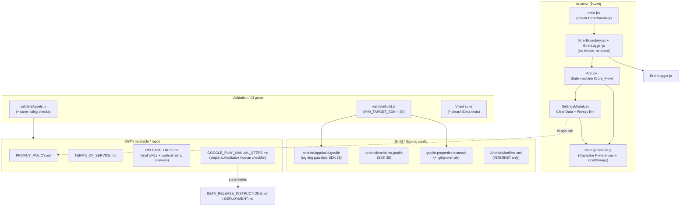

# Design Document: Android Play Release Readiness

## Overview

เอกสารนี้อธิบายการออกแบบเพื่อทำให้แอป **Career Quest** พร้อมเผยแพร่จริงบน **Google Play** (Android เป็นหลัก, iOS อยู่นอกขอบเขต) โดยยึดตาม requirements ที่อนุมัติแล้วและปรับให้เข้ากับ tech stack จริง: **React 19 + Vite 7 + Capacitor 6** (ไม่ใช่ Expo), JavaScript ES modules, ทดสอบด้วย Vitest

งานนี้เป็น **release-readiness / hardening** บนแอปที่ทำงานได้อยู่แล้ว ไม่ใช่การสร้างใหม่ หลักการออกแบบคือ **แก้ไขเท่าที่จำเป็นและไม่ rewrite subsystem ที่ทำงานดีอยู่แล้ว** โดยเน้นสามเรื่อง:

1. **Build / signing / SDK config** ให้ผ่าน policy ของ Google Play ปี 2025 (target API 35) และเก็บ secrets ออกจาก version control
2. **ปิดช่องว่างด้านพฤติกรรม (behavioral gaps)** ที่ขัดกับ requirements โดยเฉพาะ **ความหมายของ "Clear All Data"** ที่ปัจจุบันไม่ลบ preferences และ **ErrorBoundary ที่มีอยู่แต่ยังไม่ถูก mount**
3. **เอกสาร / assets / validation** สำหรับ store listing, privacy/legal และ **เอกสาร manual steps ไฟล์เดียว** ที่แยกงานของมนุษย์ออกจากงานที่ agent ทำแล้ว

### สภาพปัจจุบันที่ตรวจสอบจากโค้ดจริง (baseline)

| พื้นที่ | สถานะปัจจุบัน | ช่องว่างเทียบ requirements |
| --- | --- | --- |
| Signing | `android/app/build.gradle` มี `signingConfigs.release` อ้างอิง `RELEASE_STORE_FILE/PASSWORD/KEY_ALIAS/KEY_PASSWORD` แบบ **ตรง ๆ ไม่ guard** | `android/gradle.properties` ยังไม่มี → gradle configure ล้มทันที; ยังไม่มี `gradle.properties.example`; `.gitignore` ยังไม่กัน `android/gradle.properties` (Req 1.2, 1.3, 1.4) |
| SDK | `variables.gradle`: compileSdk/targetSdk = 34; `build.gradle` hardcode `compileSdk 34` + `targetSdkVersion 34`; minSdk 22 | ต้องขึ้น **targetSdk + compileSdk = 35** ทั้ง **สองที่** (Req 2.1, 2.2) |
| 64-bit / shrink | release: `minifyEnabled true`, `shrinkResources true`, proguard, abiFilters รวม arm64-v8a/x86_64, bundle splits เปิด | ครบแล้ว (Req 2.4, 2.5) |
| Permissions | manifest ประกาศ **เฉพาะ** `INTERNET` + FileProvider (export/import), `allowBackup="true"` | ครบ Req 3.1 แต่ต้อง document FileProvider/allowBackup (Req 3.2) |
| Clear data | `SettingsModal` ใช้ `clearAllData` จาก `dataExportImport.js` ซึ่ง **ตั้งใจเก็บ preferences ไว้** | **ขัด Req 4.2 และ 4.5** → ต้องแก้ให้ลบทั้งหมด (ดู §Data Deletion) |
| Error handling | `ErrorBoundary.jsx` + `ErrorLogger.js` มีอยู่ (log on-device, bounded 100) | **ยังไม่ถูก mount ใน `main.jsx`** → Req 8.1 ยังไม่เป็นจริง |
| Legal | ไม่มีลิงก์ privacy ใน Settings; `docs/DEPLOYMENT.md` มี draft policy | ต้องมีเอกสาร hostable + in-app link (Req 5) |
| Store assets | `docs/store_assets/` มี icon_512, feature_graphic_1024x500, 6 screenshots, description | `validateAssets.js` ตรวจแค่ `public/icons` ไม่ตรวจ store listing (Req 6.5) |
| Validation | `validateBuild.js` `MIN_TARGET_SDK = 34` | ต้องขึ้นเป็น 35 (Req 7.2 + 2.1) |
| Manual steps | `BETA_RELEASE_INSTRUCTIONS.md`, `docs/DEPLOYMENT.md` ซ้อนทับกัน | ต้องมี **ไฟล์เดียว** ที่เป็น authoritative (Req 9) |

### Research summary

- **Google Play target API policy (2025):** แอปใหม่และการอัปเดตต้อง target **API level 35 (Android 15)** จึงกำหนด `targetSdkVersion = 35`, `compileSdkVersion = 35`; `minSdkVersion = 22` ยังผ่าน (รองรับอุปกรณ์เก่ากว้าง) — [Android target API level requirements](https://developer.android.com/google/play/requirements/target-sdk). *(เนื้อหาถูกเรียบเรียงใหม่เพื่อให้เป็นไปตามข้อกำหนดด้านลิขสิทธิ์)*
- **AAB + Play App Signing:** Play บังคับ `.aab` สำหรับแอปใหม่ และใช้ Play App Signing ถือ app signing key โดยนักพัฒนาส่งด้วย upload key — [About Android App Bundles](https://developer.android.com/guide/app-bundle). การ enroll และ map upload key เป็นงานใน Play Console → อยู่ใน Manual_Steps_Document
- **Data safety / privacy:** Play ต้องการ privacy policy URL สาธารณะและ Data Safety form; เนื่องจากแอปเก็บข้อมูลบนเครื่องเท่านั้นและไม่ส่งออกนอกเครื่อง privacy policy จะระบุว่า "no off-device data collection"

---

## Architecture

Release-readiness แทรกเข้ากับสถาปัตยกรรมเดิมโดยไม่เปลี่ยน runtime flow หลัก (state machine ใน `App.jsx`) แบ่งเป็น 4 กลุ่มที่ตัดกับ layer ต่าง ๆ ของโปรเจค:



**หลักการแบ่งงาน AI vs Human:**

- **AI/agent ทำได้:** แก้ gradle/variables/manifest config, สร้าง `gradle.properties.example`, แก้ `.gitignore`, แก้ `clearAllData`, mount `ErrorBoundary`, เพิ่ม in-app privacy link, เขียน validation checks, เขียนเอกสาร markdown ทั้งหมด, รัน/เพิ่ม unit tests
- **Human เท่านั้น (อยู่ใน `GOOGLE_PLAY_MANUAL_STEPS.md`):** สร้างบัญชี Play Console + ค่าธรรมเนียม 25 USD, identity verification, สร้าง/จัดการ Upload_Keystore + enroll Play App Signing, อัปโหลด AAB, กรอก store listing / content rating / data safety, host privacy/terms ที่ URL สาธารณะ, กดเผยแพร่และ staged rollout

---

## Components and Interfaces

### C1. Signing & Build configuration (Req 1)

**ปัญหา:** `build.gradle` อ้าง `RELEASE_STORE_FILE` ฯลฯ แบบ unqualified — ถ้า properties ไม่มี Gradle จะล้มตั้งแต่ configuration phase ด้วย error ที่ไม่สื่อความ

**ออกแบบ — ทำให้ signing resilient และ fail ด้วยข้อความชัดเจน:**

ปรับ block `signingConfigs.release` ให้ guard การมีอยู่ของ properties และสร้าง release signingConfig เฉพาะเมื่อครบ:

```gradle
signingConfigs {
    release {
        def hasSigning = project.hasProperty('RELEASE_STORE_FILE') &&
                         project.hasProperty('RELEASE_STORE_PASSWORD') &&
                         project.hasProperty('RELEASE_KEY_ALIAS') &&
                         project.hasProperty('RELEASE_KEY_PASSWORD')
        if (hasSigning) {
            storeFile file(RELEASE_STORE_FILE)
            storePassword RELEASE_STORE_PASSWORD
            keyAlias RELEASE_KEY_ALIAS
            keyPassword RELEASE_KEY_PASSWORD
            v1SigningEnabled true
            v2SigningEnabled true
        }
    }
}
```

ใน `buildTypes.release` ให้ fail เฉพาะงาน bundle/assemble release ด้วยข้อความที่ระบุ property ที่ขาด (ไม่ fail debug build):

```gradle
gradle.taskGraph.whenReady { graph ->
    def needsSigning = graph.allTasks.any { it.name.toLowerCase().contains('release') }
    def missing = ['RELEASE_STORE_FILE','RELEASE_STORE_PASSWORD','RELEASE_KEY_ALIAS','RELEASE_KEY_PASSWORD']
                    .findAll { !project.hasProperty(it) }
    if (needsSigning && !missing.isEmpty()) {
        throw new GradleException("Release signing config missing: ${missing.join(', ')}. " +
            "Copy android/gradle.properties.example to android/gradle.properties and fill in values.")
    }
}
```

> หมายเหตุ: การ guard ภายใน `signingConfigs` ป้องกัน configuration-time crash; การ `throw` ใน `whenReady` ให้ **error message ที่ตั้งชื่อ property ที่ขาด** ตาม Req 1.4 โดยเฉพาะ และยังอนุญาตให้ `android:build:debug` ทำงานได้โดยไม่ต้องมี signing

**ไฟล์ `android/gradle.properties.example` (ใหม่, Req 1.2):**

```properties
# Copy to android/gradle.properties and fill in real values. DO NOT commit the real file.
RELEASE_STORE_FILE=../upload-keystore.jks
RELEASE_STORE_PASSWORD=CHANGEME
RELEASE_KEY_ALIAS=upload
RELEASE_KEY_PASSWORD=CHANGEME
```

**`.gitignore` (Req 1.3):** ปัจจุบันกัน `*.keystore`, `*.jks`, `.env` แล้ว แต่ **ยังไม่กัน `android/gradle.properties`** — เพิ่มบรรทัด:

```gitignore
android/gradle.properties
!android/gradle.properties.example
```

**Interface (ไม่เปลี่ยน):** `npm run android:build:release` → `vite build` + `cap sync android` + `gradlew bundleRelease` → AAB ที่ `android/app/build/outputs/bundle/release/app-release.aab`

**Reproducible version (Req 1.5):** `versionCode` / `versionName` อ่านจาก `defaultConfig` ใน `build.gradle` (ค่าปัจจุบัน `1` / `"1.0.0-beta.1"`) — เป็น literal เดียวใน source จึงให้ค่าเท่าเดิมทุกครั้งต่อ commit เดียวกัน การออกแบบเพียง **เอกสารกำกับ** ว่าการ bump version ต้องแก้ที่จุดนี้จุดเดียว

### C2. SDK configuration bump (Req 2)

ต้องแก้ **สองที่** เพราะ `build.gradle` hardcode ค่าไว้ไม่ได้อ่านจาก `variables.gradle`:

| ไฟล์ | ปัจจุบัน | เปลี่ยนเป็น |
| --- | --- | --- |
| `android/variables.gradle` | `compileSdkVersion = 34`, `targetSdkVersion = 34` | `35`, `35` |
| `android/app/build.gradle` | `compileSdk 34`, `targetSdkVersion 34` | `compileSdk 35`, `targetSdkVersion 35` |

`minSdkVersion = 22` คงเดิม (Req 2.3). 64-bit ABIs (`arm64-v8a`, `x86_64`) และ bundle splits มีอยู่แล้ว ไม่แตะ (Req 2.4, 2.5)

### C3. Permissions documentation (Req 3)

Manifest ประกาศ `INTERNET` อย่างเดียวแล้ว → ผ่าน Req 3.1 และ Core_Flow ไม่ต้องขอ runtime permission (Req 3.3) เพราะไม่มี dangerous permission

**งานออกแบบ:** บันทึก justification ใน `GOOGLE_PLAY_MANUAL_STEPS.md` / `PRIVACY_POLICY.md`:
- `INTERNET`: จำเป็นสำหรับ Capacitor WebView bridge และโหลด assets
- `FileProvider` (ไม่ใช่ permission แต่เป็น component): ใช้แชร์ไฟล์ export/import ภายในเครื่อง, `exported="false"` — document ตาม Req 3.2
- `allowBackup="true"`: ระบุนัยว่าข้อมูลใน default storage อาจถูก Android Auto Backup สำรอง → อธิบายใน privacy policy ว่าข้อมูลอยู่บนเครื่อง/บัญชี Google ของผู้ใช้เท่านั้น ไม่ส่งไปเซิร์ฟเวอร์แอป

### C4. Data Deletion module (Req 4) — จุดที่มี conflict ชัดเจน

**ความขัดแย้งของความหมาย "all data" (ต้องตัดสินใจ):**

- `SettingsModal` เรียก `clearAllData` จาก **`src/utils/dataExportImport.js`** ซึ่งลบเฉพาะ `career_results`, `personality_results`, `careerQuestState` และ **ตั้งใจเก็บ preferences** (`// Keep preferences`) → **ขัด Req 4.2** ("remove all stored progress *and preferences*") และ **Req 4.5** ("start with no restored prior progress")
- มี `clearAllData` ตัวที่สองใน **`src/utils/dataManager.js`** ที่ลบเฉพาะ key ชุด `careerquest_career_results` / `careerquest_personality_results` / `careerquest_statistics_cache` ผ่าน `localStorage` ตรง ๆ
- **Key mismatch:** `dataExportImport` ใช้ `StorageService` กับ key `career_results` / `personality_results` / `careerQuestState`; `dataManager` ใช้ `careerquest_*` ผ่าน `localStorage` — คนละ layer คนละ namespace

**การตัดสินใจออกแบบ (resolution):**

1. **Canonical storage layer = `StorageService`** (`src/services/StorageService.js`) ซึ่งเขียนทั้ง `@capacitor/preferences` และ `localStorage` พร้อมกัน และเป็น layer ที่ runtime (resume, settings, export/import) ใช้จริง → ถือเป็น single source of truth
2. **นิยาม "all data" = ทุก key ที่แอปเก็บผ่าน StorageService** รวม progress และ preferences (ดู §Data Models สำหรับรายการเต็ม)
3. แก้ **`clearAllData` ใน `dataExportImport.js`** ให้ลบ **ทุก key** รวม preferences แล้วตั้ง sensible defaults หลังล้าง (theme = ค่า default ของ `ThemeContext`, language = `'en'`, music = default) — ให้แอปเปิดใหม่เหมือนติดตั้งครั้งแรก (Req 4.5)
4. **`dataManager.clearAllData` ที่ใช้ `careerquest_*` keys:** ตรวจว่าไม่มี path ใดใน runtime ที่เขียน key ชุดนั้น หากไม่ถูกใช้งานจริงให้คง behavior เดิม (ลบ key ของตัวเองได้) แต่ **ไม่ใช่**ตัวที่ UI เรียก; เพื่อความ robust จะให้ `clearAllData` ตัว canonical ลบ `careerquest_*` keys ด้วย (กันข้อมูลค้างข้าม layer)

**รายละเอียด `clearAllData` ใหม่ (dataExportImport.js):**

```javascript
// Canonical: ลบทุก key ที่แอปเก็บผ่าน StorageService (progress + preferences)
const ALL_STORAGE_KEYS = [
    // progress / results (StorageService namespace)
    'career_results', 'personality_results', 'careerQuestState',
    // preferences
    'theme', 'careerquest_language', 'careerquest_music', 'careerquest_volume',
    // legacy dataManager namespace (กันข้อมูลค้าง)
    'careerquest_career_results', 'careerquest_personality_results', 'careerquest_statistics_cache',
];

export async function clearAllData() {
    try {
        for (const key of ALL_STORAGE_KEYS) {
            await StorageService.remove(key);
        }
        return { success: true };
    } catch (error) {
        return { success: false, error: error.message };
    }
}
```

**Confirmation UX (Req 4.3, 4.4):** ปัจจุบันใช้ `window.confirm()` + `alert()` (ทำงานได้ใน Capacitor WebView). ออกแบบให้คงพฤติกรรม "ขอ confirm ก่อนลบ" และ "แจ้งผลหลังลบ" ไว้ แต่ **แนะนำ** เปลี่ยนเป็น in-app modal confirmation (reuse pattern ของ modal เดิม) เพื่อ UX สม่ำเสมอและ **testable** กว่า `window.confirm` ที่ mock ยากใน Vitest. การ reload หลังล้าง (ปัจจุบัน import flow ใช้ `window.location.reload()`) จะใช้ซ้ำเพื่อรีเซ็ต state machine ให้ไม่มี progress ค้าง (Req 4.5)

### C5. Legal docs + in-app link (Req 5)

- **เขียนใหม่ 2 ไฟล์ hostable:** `PRIVACY_POLICY.md`, `TERMS_OF_SERVICE.md` (ที่ root หรือ `docs/`) โดย privacy policy ระบุชัด: แอปเก็บข้อมูลใดบนเครื่อง (career/personality results, progress, preferences ผ่าน StorageService) และ **ไม่มีการส่งข้อมูลออกนอกเครื่อง** (Req 5.5). ใช้ draft ใน `docs/DEPLOYMENT.md` เป็นฐาน
- **In-app link (Req 5.4):** เพิ่ม section ใหม่ใน `SettingsModal` ("Privacy & Legal") ที่มีลิงก์ไป Privacy Policy. ใน Capacitor ให้เปิดด้วย placeholder URL ก่อน (ค่าคงที่ `PRIVACY_POLICY_URL`) และเปิดผ่าน `window.open(url, '_system')` / anchor target `_blank`
- **URL scheme + บันทึก final URLs (Req 5.6):** เอกสาร `RELEASE_URLS.md` เก็บ URL จริงเมื่อ host เสร็จ (เช่น GitHub Pages / Cloudflare Pages ตามคู่มือ) + Support_Contact (email/URL). placeholder ในโค้ดชี้ไป constant เดียวเพื่อแก้ที่เดียว

### C6. Store-asset validation (Req 6)

Store assets มีครบใน `docs/store_assets/` แต่ `validateAssets.js` ตรวจแค่ `public/icons`. ออกแบบเพิ่ม **validation step สำหรับ store listing** (เพิ่มใน `validateAssets.js` ให้รันผ่าน `release:prepare`):

- `docs/store_assets/icon_512.png` มีอยู่ (Req 6.1)
- `docs/store_assets/feature_graphic_1024x500.png` มีอยู่ (Req 6.2)
- นับไฟล์ screenshot ใน `docs/store_assets/` ≥ 2 (Req 6.3)
- ตรวจความยาว description: short ≤ 80 ตัวอักษร, full ≤ 4000 ตัวอักษร โดยอ่านจากไฟล์ที่กำหนด (แยก short/full ให้ชัดเจน — ปัจจุบัน `store_description.txt` เป็น full) (Req 6.4)
- รายงาน asset ที่ขาดและ `exit(1)` เช่นเดียวกับ check เดิม (Req 6.5)
- **Content rating answers (Req 6.6):** บันทึกใน `RELEASE_URLS.md` หรือ section ใน manual steps doc

> หมายเหตุ (dimensions): การตรวจขนาดพิกเซลจริง (512×512, 1024×500) ต้องอ่าน image header; เพื่อไม่เพิ่ม dependency จะตรวจ **การมีอยู่ของไฟล์ตามชื่อ/คอน벤션ขนาด** เป็น gate หลัก และระบุการตรวจพิกเซลเป๊ะ ๆ เป็นขั้นตอน manual verification ใน checklist (ชื่อไฟล์สื่อขนาดอยู่แล้ว)

### C7. Verification & real-device checklist (Req 7)

- `npm test` (`vitest --run`) ต้องผ่านทั้งหมด (Req 7.1) — เพิ่ม unit tests สำหรับ `clearAllData` และ validation (ดู Testing Strategy)
- `npm run release:prepare` ต้องผ่านไม่มี error (Req 7.2) — ขึ้นกับ `validateAssets.js` + `validateBuild.js` (MIN_TARGET_SDK = 35)
- **Real-device checklist (Req 7.3-7.5):** เอกสาร checklist (section ใน manual steps doc หรือไฟล์แยก) ครอบคลุม Core_Flow จาก state machine ใน `App.jsx`: `HOME → SELECT_GROUP → SELECT_JOB → PLAYING → RESULT`, `PERSONALITY_TEST → PT_RESULT`, resume ผ่าน `ResumeModal` + `StorageService` key `careerQuestState`, สลับภาษา (en/th/zh), สลับธีม, และ cold start ไม่ crash

### C8. Error handling & on-device logging (Req 8)

**ช่องว่างสำคัญ:** `ErrorBoundary.jsx` + `ErrorLogger.js` มีครบและ log on-device (in-memory, bounded 100 รายการ) แต่ **`main.jsx` ยัง render `<App/>` ตรง ๆ ไม่ได้ wrap** → Req 8.1 ยังไม่เป็นจริง

**ออกแบบ:**

1. **Mount ErrorBoundary ใน `main.jsx`** ครอบ `<App/>` (Req 8.1). fallback UI + ปุ่ม "Try Again" (`handleReset`) และ "Go Home" (`handleGoHome`) มีอยู่แล้วใน component → ตอบ Req 8.2
2. **On-device logging policy (Req 8.3):** `ErrorLogger` เก็บใน memory ไม่ส่งออกนอกเครื่องอยู่แล้ว — คงไว้ และ document นโยบายว่า diagnostics อยู่บนเครื่องเท่านั้น ไม่มี crash reporting / analytics ที่ส่งข้อมูลออก
3. **PII exclusion (Req 8.5):** `ErrorLogger.logError` ปัจจุบันเก็บ `userAgent` และ `window.location.href` — ทบทวนให้ไม่บันทึกข้อมูลที่ระบุตัวตนได้; career/personality results ไม่ถูก log อยู่แล้ว. ระบุนโยบายชัดว่า log เก็บเฉพาะ message/stack/component stack ไม่เก็บเนื้อหาผู้ใช้
4. **Req 8.4 (conditional):** โครงการ **ไม่เปิด** crash reporting/analytics ที่ส่งข้อมูลออก → ข้อนี้เป็น vacuously satisfied; เอกสารระบุว่าหากเพิ่มในอนาคตต้องขอ consent + ประกาศใน Data Safety form

### C9. Manual steps document (Req 9)

ไฟล์เดียว authoritative: **`GOOGLE_PLAY_MANUAL_STEPS.md`** (เสนอวางที่ `docs/` ของโปรเจค Career_Quest) ครอบคลุม Req 9.2-9.7 และ **แยกชัด** ว่าขั้นไหน human-only ขั้นไหน agent ทำแล้ว (Req 9.8) โดยใช้ตารางหรือ tag `[HUMAN]` / `[DONE BY AGENT]`. `BETA_RELEASE_INSTRUCTIONS.md` และ `docs/DEPLOYMENT.md` ที่ซ้อนทับให้ **อ้างอิง/supersede** ไม่ duplicate เนื้อหา

เนื้อหา human-only: สร้างบัญชี Play Console + ค่าธรรมเนียม 25 USD (9.2), identity verification (9.3), enroll Play App Signing + ให้ Upload_Keystore (9.4), อัปโหลด AAB เข้า release track (9.5), store listing + content rating + data safety (9.6), progression internal → closed → production + staged rollout (9.7)

---

## Data Models

### Storage keys enumeration (ผ่าน StorageService — canonical)

| Key | ประเภท | หมวด | clearAllData ลบ? |
| --- | --- | --- | --- |
| `career_results` | array | progress/results | ✅ |
| `personality_results` | array | progress/results | ✅ |
| `careerQuestState` | JSON string | progress (resume/auto-save) | ✅ |
| `theme` | `'dark'`/`'light'` | preference | ✅ (reset → default) |
| `careerquest_language` | `'en'`/`'th'`/`'zh'` | preference | ✅ (reset → `'en'`) |
| `careerquest_music` | `'true'`/`'false'` | preference | ✅ (reset → default) |
| `careerquest_volume` | number string | preference | ✅ (reset → default) |

### Legacy keys (dataManager namespace — localStorage ตรง)

| Key | หมายเหตุ | clearAllData ลบ? |
| --- | --- | --- |
| `careerquest_career_results` | legacy/parallel namespace | ✅ (กันข้อมูลค้าง) |
| `careerquest_personality_results` | legacy | ✅ |
| `careerquest_statistics_cache` | cache | ✅ |

**หลังล้าง (post-clear state):** ไม่มี progress; preferences กลับเป็น default; เปิดแอปใหม่เข้าสู่ `HOME` โดยไม่มี resume (Req 4.5)

### Build/version model (ไม่เปลี่ยนค่า, เอกสารกำกับ)

| Field | ค่า | ที่มา |
| --- | --- | --- |
| `versionCode` | `1` | `build.gradle` defaultConfig |
| `versionName` | `"1.0.0-beta.1"` | `build.gradle` defaultConfig |
| `applicationId` | `com.careerquest.app` | `build.gradle` |
| `minSdkVersion` | `22` | `variables.gradle` + `build.gradle` |
| `targetSdkVersion` | `35` (เป้าหมาย) | **ทั้ง** `variables.gradle` + `build.gradle` |
| `compileSdk` | `35` (เป้าหมาย) | **ทั้ง** `variables.gradle` + `build.gradle` |

### Diagnostic log entry (ErrorLogger — on-device)

| Field | เก็บ? | หมายเหตุ PII |
| --- | --- | --- |
| `timestamp`, `message`, `stack`, `context.componentStack` | ✅ | ไม่ใช่ PII |
| `userAgent`, `url` | ทบทวน | พิจารณาตัดออกเพื่อ Req 8.5 |
| career/personality content | ❌ | ไม่ log เนื้อหาผู้ใช้ |

---

## Correctness Properties

*A property is a characteristic or behavior that should hold true across all valid executions of a system—essentially, a formal statement about what the system should do. Properties serve as the bridge between human-readable specifications and machine-verifiable correctness guarantees.*

> ขอบเขต PBT ของฟีเจอร์นี้แคบ: ส่วนใหญ่เป็น IaC/config (gradle, manifest, SDK bump), การเพิ่ม validation script, การ mount component และเอกสาร ซึ่ง **ไม่เหมาะกับ property-based testing** (ใช้ example-based tests / snapshot / schema checks แทน) ส่วนที่ **เหมาะกับ PBT** คือ logic ของ `clearAllData` ซึ่งเป็น pure-ish function เหนือ StorageService ที่มี universal behavior (ลบทุก key, idempotent) ด้านล่างจึงมี property เฉพาะส่วนนั้น

### Property 1: Clear All Data ล้างทุก key ที่แอปเก็บ

*For any* ชุดสถานะเริ่มต้นของ StorageService ที่มี key ใด ๆ จากรายการ `ALL_STORAGE_KEYS` (progress และ/หรือ preferences ด้วยค่าใด ๆ) หลังเรียก `clearAllData()` สำเร็จ การ `get` ทุก key ในรายการนั้นต้องคืน `null` (ไม่มีข้อมูล progress หรือ preference เดิมหลงเหลือ)

**Validates: Requirements 4.2, 4.5**

### Property 2: Clear All Data เป็น idempotent

*For any* สถานะของ StorageService การเรียก `clearAllData()` สองครั้งติดกันต้องให้ผลลัพธ์ปลายทางเหมือนเรียกครั้งเดียว (ทุก key = `null`) และครั้งที่สองต้องไม่ error

**Validates: Requirements 4.2**

---

## Error Handling

| สถานการณ์ | การจัดการ | requirement |
| --- | --- | --- |
| Runtime error ใน React tree | `ErrorBoundary` (mount ใน `main.jsx`) จับและแสดง fallback UI แทนจอว่าง | 8.1 |
| ผู้ใช้ติดอยู่ที่ fallback | ปุ่ม "Try Again" (reset state) และ "Go Home" (`/`) | 8.2 |
| Uncaught error / unhandled rejection | `ErrorLogger.initializeErrorHandlers()` (auto-init) เก็บ on-device, bounded 100 | 8.3, 8.5 |
| Signing properties ขาดตอน build release | Gradle `throw GradleException` ระบุชื่อ property ที่ขาด | 1.4 |
| Signing properties ขาดตอน `release:prepare` | `validateBuild.js` รายงาน missing + `exit(1)` | 1.4, 7.2 |
| Store asset ขาด | `validateAssets.js` รายงาน + `exit(1)` | 6.5 |
| `clearAllData` ล้มเหลวบางส่วน | คืน `{ success: false, error }`; UI แจ้งผู้ใช้ (ไม่ reload) | 4.3 |
| Import ข้อมูลไฟล์ผิด format | validate ก่อน (`validateData`) คืน error ที่สื่อความ | — (เดิม) |

---

## Testing Strategy

**Dual approach:** ส่วนใหญ่ของฟีเจอร์นี้เป็น config/docs/validation จึงใช้ **unit tests + script-level checks + manual device checklist** เป็นหลัก และใช้ **property-based tests เฉพาะ `clearAllData`** (ส่วนเดียวที่มี universal property ที่คุ้มค่า)

### Unit / example-based tests (Vitest, happy-dom)

- **`clearAllData` (dataExportImport):** ตั้งค่า StorageService ให้มีทั้ง progress + preferences แล้วยืนยันว่าหลังเรียกทุก key = `null` และ `success: true`; กรณี remove ล้มเหลวคืน `{ success: false }` (ครอบ Req 4.2, 4.3)
- **ErrorBoundary mount:** render tree ที่โยน error แล้วยืนยันว่าเห็น fallback UI + ปุ่ม recovery (Req 8.1, 8.2)
- **ErrorLogger PII:** ยืนยันว่า entry ไม่มี field เนื้อหาผู้ใช้ (Req 8.5)
- **In-app privacy link:** ยืนยันว่า SettingsModal render ลิงก์ Privacy Policy (Req 5.4)

### Script-level / integration checks

- **`validateBuild.js`:** ยืนยัน `MIN_TARGET_SDK = 35` และ fail เมื่อ targetSdk < 35 หรือ signing ขาด (Req 2.1, 1.4, 7.2)
- **`validateAssets.js`:** ยืนยัน store listing checks (icon_512, feature_graphic_1024x500, screenshots ≥ 2, description length) และ fail เมื่อขาด (Req 6.5)
- `npm test` + `npm run release:prepare` ต้องผ่าน (Req 7.1, 7.2)

### Property-based tests

- ใช้ไลบรารี **fast-check** (มาตรฐานของ JS/Vitest; **ไม่** เขียน PBT เอง), อย่างน้อย **100 iterations** ต่อ property, generator สุ่มชุด key/ค่าใน StorageService (ใช้ in-memory mock ของ Preferences + localStorage)
- Tag แต่ละ test ด้วย comment: `// Feature: android-play-release-readiness, Property 1: Clear All Data ล้างทุก key ที่แอปเก็บ` และ `Property 2: Clear All Data เป็น idempotent`
- แต่ละ property implement ด้วย **หนึ่ง** property-based test

### Real-device / emulator checklist (manual, Req 7.3-7.5)

เอกสาร checklist ครอบคลุม: cold start ไม่ crash (7.3); Core_Flow เต็ม — career selection, MBTI test, resume/auto-save, สลับภาษา, สลับธีม (7.4); อ้างอิง state machine states จาก `App.jsx`

---

## Design decisions → Requirements mapping

| การตัดสินใจออกแบบ | เหตุผล | Requirements |
| --- | --- | --- |
| Guard `signingConfigs` + `throw` ระบุ property ที่ขาด | กัน configure crash และให้ error ชัดตาม EARS "names the missing properties"; debug build ยังทำงาน | 1.1, 1.4 |
| สร้าง `gradle.properties.example` | document keys โดยไม่มี credential จริง | 1.2 |
| เพิ่ม `android/gradle.properties` ใน `.gitignore` | ปิดช่องว่าง secrets (keystore ถูกกันแล้ว) | 1.3 |
| version เป็น literal เดียวใน build.gradle + เอกสารกำกับ | reproducible ต่อ commit | 1.5 |
| ขึ้น SDK = 35 ทั้ง variables.gradle + build.gradle | build.gradle hardcode ไม่อ่าน variables; Play policy 2025 | 2.1, 2.2 |
| คง minSdk 22, abiFilters, bundle splits | ครบ 64-bit/AAB อยู่แล้ว ไม่แตะ | 2.3, 2.4, 2.5 |
| document FileProvider/allowBackup/INTERNET | INTERNET-only อยู่แล้ว ต้อง justify ส่วนที่เหลือ | 3.1, 3.2, 3.3 |
| **แก้ `clearAllData` ให้ลบ preferences + legacy keys; StorageService = canonical** | **แก้ conflict Req 4.2/4.5** กับ comment "Keep preferences" และ key mismatch สอง layer | 4.2, 4.5 |
| คง confirm-before-delete + confirmation; แนะนำ in-app modal | ทำได้อยู่แล้วด้วย confirm/alert แต่ modal testable กว่า | 4.1, 4.3, 4.4 |
| เขียน PRIVACY_POLICY.md / TERMS_OF_SERVICE.md + in-app link + RELEASE_URLS.md | ต้องมีเอกสาร hostable + ลิงก์ในแอป + บันทึก URL | 5.1-5.6 |
| ขยาย validateAssets.js ตรวจ store listing | assets มีแต่ validation ไม่ครอบ | 6.1-6.5 |
| บันทึก content rating answers ในเอกสาร | input สำหรับ Play Console | 6.6 |
| ขึ้น MIN_TARGET_SDK = 35 ใน validateBuild.js | gate ให้สอดคล้อง SDK bump | 2.1, 7.2 |
| real-device checklist อิง states ของ App.jsx | ครอบ Core_Flow จริง | 7.3-7.5 |
| **Mount ErrorBoundary ใน main.jsx** | component มีแต่ยังไม่ถูกใช้ | 8.1, 8.2 |
| คง ErrorLogger on-device + ทบทวน PII | ไม่ส่งข้อมูลออก, ตัด PII | 8.3, 8.4, 8.5 |
| `GOOGLE_PLAY_MANUAL_STEPS.md` ไฟล์เดียว authoritative | รวม human-only steps, supersede ไฟล์ซ้ำ | 9.1-9.8 |

---

## หมายเหตุขอบเขต

- iOS อยู่นอกขอบเขต (งานอนาคต)
- ไม่ rewrite state machine, StorageService, หรือ UI subsystem ที่ทำงานดีอยู่แล้ว
- การ host privacy/terms, สร้าง keystore, และงานใน Play Console เป็น human-only (อยู่ใน manual steps doc) — agent เตรียม config/code/docs/validation ให้พร้อมเท่านั้น
