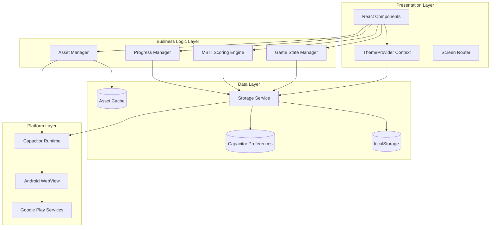

# Technical Design Document: Career Quest Enhancements

## Overview

This design document specifies the technical architecture for five major enhancements to the Career Quest mobile application:

1. **Google Play Store Deployment Configuration** - Complete build and release pipeline for Play Store submission
2. **Light/Dark Theme System** - Comprehensive theming architecture with persistent user preferences
3. **Enhanced Progress Saving** - Robust dual-storage strategy for session persistence
4. **GIF Animation Integration** - Lazy-loaded, cached animation system with fallback handling
5. **Improved MBTI Testing System** - Expanded question bank with comprehensive personality results

These enhancements transform Career Quest from a functional prototype into a production-ready, market-deployable Android application with professional UX features and reliable data persistence.

### Technology Stack

- **Frontend**: React 19.1.0, Vite 7.0.0
- **Mobile Framework**: Capacitor 6.0.0
- **Platform**: Android (minSdk 22, targetSdk 34+)
- **Build System**: Gradle 8.x, Android Gradle Plugin 8.x
- **Animation**: Framer Motion 12.0.0
- **Storage**: localStorage + Capacitor Preferences API
- **State Management**: React Context API + hooks

### Design Principles

1. **Progressive Enhancement**: Core functionality works without premium features
2. **Offline-First**: All features function without network connectivity
3. **Performance**: Lazy loading, code splitting, and asset optimization
4. **Accessibility**: WCAG AA compliance for theme contrast and UI interactions
5. **Data Integrity**: Validation, retry logic, and fallback mechanisms
6. **Platform Integration**: Native Android capabilities via Capacitor plugins

## Architecture

### System Architecture Diagram



### Component Hierarchy

```
App (Root)
├── ThemeProvider (Context)
│   ├── ThemeContext (state + actions)
│   └── CSS Variables (dynamic injection)
├── StorageProvider (Context)
│   ├── StorageService (dual-storage abstraction)
│   └── ProgressManager (session persistence)
├── AssetProvider (Context)
│   ├── GIFLoader (lazy loading)
│   └── AssetCache (memory + disk)
├── NavBar
│   ├── ThemeToggle
│   ├── MusicToggle
│   └── SettingsButton
├── Screen Router (AnimatePresence)
│   ├── HomeScreen
│   ├── CareerSelection
│   ├── GameScreen
│   │   └── GIFDisplay (animated feedback)
│   ├── ResultScreen
│   │   └── GIFDisplay (celebration)
│   ├── PersonalityTest (Enhanced)
│   │   ├── QuestionBank (60+ questions)
│   │   └── ProgressIndicator
│   └── PersonalityResult (Enhanced)
│       ├── MBTITypeDisplay
│       ├── CareerRecommendations (8+ per type)
│       ├── PersonalGrowthSection
│       ├── LearningStyleSection
│       └── AIEraStrategiesSection
└── Modals
    ├── SettingsModal (theme, music, language)
    ├── ResumeModal (session recovery)
    └── ExportModal (data portability)
```

## Components and Interfaces

### 1. Theme System Architecture

#### ThemeContext Interface

```typescript
interface ThemeContextValue {
  theme: 'light' | 'dark';
  setTheme: (theme: 'light' | 'dark') => void;
  toggleTheme: () => void;
  isLoading: boolean;
}

interface ThemeColors {
  // Background colors
  bgPrimary: string;
  bgSecondary: string;
  bgTertiary: string;
  bgCard: string;
  bgGlass: string;
  bgGlassHover: string;
  
  // Text colors
  textPrimary: string;
  textSecondary: string;
  textMuted: string;
  textAccent: string;
  
  // Accent colors
  primaryCyan: string;
  primaryMagenta: string;
  primaryPurple: string;
  primaryBlue: string;
  primaryGreen: string;
  primaryOrange: string;
  
  // Shadows
  shadowSm: string;
  shadowMd: string;
  shadowLg: string;
  shadowGlowCyan: string;
  shadowGlowMagenta: string;
}
```

#### ThemeProvider Implementation

```javascript
// src/contexts/ThemeContext.jsx
import { createContext, useContext, useState, useEffect } from 'react';
import { Preferences } from '@capacitor/preferences';

const ThemeContext = createContext(null);

const THEME_STORAGE_KEY = 'careerquest_theme';

export const ThemeProvider = ({ children }) => {
  const [theme, setThemeState] = useState('dark');
  const [isLoading, setIsLoading] = useState(true);

  // Load theme on mount
  useEffect(() => {
    loadTheme();
  }, []);

  const loadTheme = async () => {
    try {
      // Try Capacitor Preferences first
      const { value } = await Preferences.get({ key: THEME_STORAGE_KEY });
      if (value) {
        applyTheme(value);
        return;
      }
      
      // Fallback to localStorage
      const localValue = localStorage.getItem(THEME_STORAGE_KEY);
      if (localValue) {
        applyTheme(localValue);
        return;
      }
      
      // Default to dark theme
      applyTheme('dark');
    } catch (error) {
      console.error('Failed to load theme:', error);
      applyTheme('dark');
    } finally {
      setIsLoading(false);
    }
  };

  const applyTheme = (newTheme) => {
    setThemeState(newTheme);
    document.documentElement.setAttribute('data-theme', newTheme);
  };

  const setTheme = async (newTheme) => {
    applyTheme(newTheme);
    
    // Save to both storage mechanisms
    try {
      await Preferences.set({ key: THEME_STORAGE_KEY, value: newTheme });
      localStorage.setItem(THEME_STORAGE_KEY, newTheme);
    } catch (error) {
      console.error('Failed to save theme:', error);
    }
  };

  const toggleTheme = () => {
    setTheme(theme === 'dark' ? 'light' : 'dark');
  };

  return (
    <ThemeContext.Provider value={{ theme, setTheme, toggleTheme, isLoading }}>
      {children}
    </ThemeContext.Provider>
  );
};

export const useTheme = () => {
  const context = useContext(ThemeContext);
  if (!context) {
    throw new Error('useTheme must be used within ThemeProvider');
  }
  return context;
};
```

#### CSS Variable System

The theme system uses CSS custom properties defined in `src/index.css` with dynamic updates via `data-theme` attribute:

```css
/* Dark theme (default) */
:root {
  --bg-primary: #0a0a1f;
  --bg-secondary: #111128;
  --text-primary: #ffffff;
  --text-secondary: rgba(255, 255, 255, 0.7);
  /* ... other variables */
}

/* Light theme override */
[data-theme="light"] {
  --bg-primary: #f0f4ff;
  --bg-secondary: #ffffff;
  --text-primary: #0a0a1f;
  --text-secondary: rgba(10, 10, 31, 0.7);
  /* ... other variables */
}
```

### 2. Storage Service Architecture

#### StorageService Interface

```typescript
interface StorageService {
  // Core operations
  get<T>(key: string): Promise<T | null>;
  set<T>(key: string, value: T): Promise<boolean>;
  remove(key: string): Promise<boolean>;
  clear(): Promise<boolean>;
  
  // Validation
  validate<T>(key: string, schema: Schema): Promise<boolean>;
  
  // Migration
  migrate(fromVersion: number, toVersion: number): Promise<boolean>;
}

interface StorageOptions {
  retryAttempts?: number;
  retryDelay?: number;
  validateOnRead?: boolean;
  useCompression?: boolean;
}
```

#### Dual-Storage Implementation

```javascript
// src/services/StorageService.js
import { Preferences } from '@capacitor/preferences';

class StorageService {
  constructor(options = {}) {
    this.retryAttempts = options.retryAttempts || 3;
    this.retryDelay = options.retryDelay || 100;
    this.validateOnRead = options.validateOnRead !== false;
  }

  /**
   * Get value with fallback chain: Capacitor Preferences -> localStorage -> null
   */
  async get(key) {
    try {
      // Try Capacitor Preferences first (native storage)
      const { value } = await Preferences.get({ key });
      if (value !== null) {
        return JSON.parse(value);
      }
      
      // Fallback to localStorage
      const localValue = localStorage.getItem(key);
      if (localValue !== null) {
        const parsed = JSON.parse(localValue);
        // Sync to Capacitor Preferences for future reads
        await this.set(key, parsed);
        return parsed;
      }
      
      return null;
    } catch (error) {
      console.error(`StorageService.get failed for key "${key}":`, error);
      
      // Last resort: try localStorage directly
      try {
        const localValue = localStorage.getItem(key);
        return localValue ? JSON.parse(localValue) : null;
      } catch {
        return null;
      }
    }
  }

  /**
   * Set value with retry logic and dual-storage persistence
   */
  async set(key, value) {
    const serialized = JSON.stringify(value);
    let lastError = null;
    
    for (let attempt = 0; attempt < this.retryAttempts; attempt++) {
      try {
        // Write to both storage mechanisms
        await Promise.all([
          Preferences.set({ key, value: serialized }),
          this.setLocalStorage(key, serialized)
        ]);
        return true;
      } catch (error) {
        lastError = error;
        console.warn(`StorageService.set attempt ${attempt + 1} failed:`, error);
        
        if (attempt < this.retryAttempts - 1) {
          await this.delay(this.retryDelay * (attempt + 1));
        }
      }
    }
    
    console.error(`StorageService.set failed after ${this.retryAttempts} attempts:`, lastError);
    return false;
  }

  /**
   * Remove value from both storage mechanisms
   */
  async remove(key) {
    try {
      await Promise.all([
        Preferences.remove({ key }),
        Promise.resolve(localStorage.removeItem(key))
      ]);
      return true;
    } catch (error) {
      console.error(`StorageService.remove failed for key "${key}":`, error);
      return false;
    }
  }

  /**
   * Clear all stored data
   */
  async clear() {
    try {
      await Promise.all([
        Preferences.clear(),
        Promise.resolve(localStorage.clear())
      ]);
      return true;
    } catch (error) {
      console.error('StorageService.clear failed:', error);
      return false;
    }
  }

  /**
   * Validate data integrity
   */
  async validate(key, validator) {
    try {
      const data = await this.get(key);
      if (data === null) return true; // No data is valid
      
      return validator(data);
    } catch {
      return false;
    }
  }

  // Helper methods
  setLocalStorage(key, value) {
    return new Promise((resolve, reject) => {
      try {
        localStorage.setItem(key, value);
        resolve();
      } catch (error) {
        reject(error);
      }
    });
  }

  delay(ms) {
    return new Promise(resolve => setTimeout(resolve, ms));
  }
}

export const storageService = new StorageService();
```

### 3. Progress Manager Architecture

#### ProgressManager Interface

```typescript
interface GameProgress {
  gameState: 'PLAYING' | 'PERSONALITY_TEST';
  currentCareer?: Career;
  currentScenarioIndex?: number;
  stats?: Stats;
  feedback?: string;
  ptIndex?: number;
  ptAnswers?: Record<string, number>;
  ptTraits?: Traits;
  mbtiDimensions?: MBTIDimensions;
  savedAt: string;
  version: string;
}

interface ProgressManager {
  saveProgress(progress: GameProgress): Promise<boolean>;
  loadProgress(): Promise<GameProgress | null>;
  clearProgress(): Promise<boolean>;
  hasProgress(): Promise<boolean>;
}
```

#### ProgressManager Implementation

```javascript
// src/services/ProgressManager.js
import { storageService } from './StorageService.js';

const PROGRESS_KEY = 'careerQuestState';
const PROGRESS_VERSION = '2.0';

class ProgressManager {
  /**
   * Save current game progress
   */
  async saveProgress(progress) {
    const progressData = {
      ...progress,
      savedAt: new Date().toISOString(),
      version: PROGRESS_VERSION
    };
    
    const success = await storageService.set(PROGRESS_KEY, progressData);
    
    if (!success) {
      console.error('Failed to save progress');
    }
    
    return success;
  }

  /**
   * Load saved progress with validation
   */
  async loadProgress() {
    try {
      const progress = await storageService.get(PROGRESS_KEY);
      
      if (!progress) {
        return null;
      }
      
      // Validate progress data
      if (!this.validateProgress(progress)) {
        console.warn('Invalid progress data, clearing');
        await this.clearProgress();
        return null;
      }
      
      // Check if progress is stale (older than 7 days)
      const savedDate = new Date(progress.savedAt);
      const daysSince = (Date.now() - savedDate.getTime()) / (1000 * 60 * 60 * 24);
      
      if (daysSince > 7) {
        console.info('Progress is stale, clearing');
        await this.clearProgress();
        return null;
      }
      
      return progress;
    } catch (error) {
      console.error('Failed to load progress:', error);
      return null;
    }
  }

  /**
   * Clear saved progress
   */
  async clearProgress() {
    return await storageService.remove(PROGRESS_KEY);
  }

  /**
   * Check if progress exists
   */
  async hasProgress() {
    const progress = await this.loadProgress();
    return progress !== null;
  }

  /**
   * Validate progress data structure
   */
  validateProgress(progress) {
    if (!progress || typeof progress !== 'object') {
      return false;
    }
    
    // Must have gameState
    if (!progress.gameState || !['PLAYING', 'PERSONALITY_TEST'].includes(progress.gameState)) {
      return false;
    }
    
    // Validate PLAYING state
    if (progress.gameState === 'PLAYING') {
      if (!progress.currentCareer || typeof progress.currentScenarioIndex !== 'number') {
        return false;
      }
    }
    
    // Validate PERSONALITY_TEST state
    if (progress.gameState === 'PERSONALITY_TEST') {
      if (typeof progress.ptIndex !== 'number' || !progress.ptAnswers) {
        return false;
      }
    }
    
    return true;
  }

  /**
   * Auto-save on visibility change
   */
  setupAutoSave(getProgressFn) {
    const handleVisibilityChange = async () => {
      if (document.visibilityState === 'hidden') {
        const progress = getProgressFn();
        if (progress) {
          await this.saveProgress(progress);
        }
      }
    };
    
    document.addEventListener('visibilitychange', handleVisibilityChange);
    
    return () => {
      document.removeEventListener('visibilitychange', handleVisibilityChange);
    };
  }
}

export const progressManager = new ProgressManager();
```

### 4. GIF Animation System

#### GIFLoader Interface

```typescript
interface GIFAsset {
  id: string;
  url: string;
  category: string;
  fallbackImage?: string;
  preload?: boolean;
}

interface GIFLoader {
  load(id: string): Promise<string>;
  preload(ids: string[]): Promise<void>;
  clearCache(): void;
  getCacheSize(): number;
}

interface GIFDisplayProps {
  gifId: string;
  category: string;
  fallback?: string;
  className?: string;
  onLoad?: () => void;
  onError?: (error: Error) => void;
}
```

#### GIF Asset Structure

```javascript
// src/data/gifAssets.js
export const GIF_CATEGORIES = {
  CAREER_START: 'career_start',
  FEEDBACK_POSITIVE: 'feedback_positive',
  FEEDBACK_NEGATIVE: 'feedback_negative',
  FEEDBACK_NEUTRAL: 'feedback_neutral',
  CELEBRATION: 'celebration',
  THINKING: 'thinking'
};

export const gifAssets = {
  // Career start animations (5 per category)
  career_start: [
    { id: 'tech_start_1', url: '/assets/gifs/tech/start_1.gif', category: 'tech' },
    { id: 'tech_start_2', url: '/assets/gifs/tech/start_2.gif', category: 'tech' },
    { id: 'healthcare_start_1', url: '/assets/gifs/healthcare/start_1.gif', category: 'healthcare' },
    // ... more entries
  ],
  
  // Feedback animations
  feedback_positive: [
    { id: 'success_1', url: '/assets/gifs/feedback/success_1.gif' },
    { id: 'success_2', url: '/assets/gifs/feedback/success_2.gif' },
    { id: 'success_3', url: '/assets/gifs/feedback/success_3.gif' },
    { id: 'success_4', url: '/assets/gifs/feedback/success_4.gif' },
    { id: 'success_5', url: '/assets/gifs/feedback/success_5.gif' },
  ],
  
  feedback_negative: [
    { id: 'mistake_1', url: '/assets/gifs/feedback/mistake_1.gif' },
    { id: 'mistake_2', url: '/assets/gifs/feedback/mistake_2.gif' },
    { id: 'mistake_3', url: '/assets/gifs/feedback/mistake_3.gif' },
    { id: 'mistake_4', url: '/assets/gifs/feedback/mistake_4.gif' },
    { id: 'mistake_5', url: '/assets/gifs/feedback/mistake_5.gif' },
  ],
  
  feedback_neutral: [
    { id: 'neutral_1', url: '/assets/gifs/feedback/neutral_1.gif' },
    { id: 'neutral_2', url: '/assets/gifs/feedback/neutral_2.gif' },
    { id: 'neutral_3', url: '/assets/gifs/feedback/neutral_3.gif' },
    { id: 'neutral_4', url: '/assets/gifs/feedback/neutral_4.gif' },
    { id: 'neutral_5', url: '/assets/gifs/feedback/neutral_5.gif' },
  ],
  
  // Celebration animations
  celebration: [
    { id: 'celebrate_1', url: '/assets/gifs/celebration/celebrate_1.gif' },
    { id: 'celebrate_2', url: '/assets/gifs/celebration/celebrate_2.gif' },
    { id: 'celebrate_3', url: '/assets/gifs/celebration/celebrate_3.gif' },
    { id: 'celebrate_4', url: '/assets/gifs/celebration/celebrate_4.gif' },
    { id: 'celebrate_5', url: '/assets/gifs/celebration/celebrate_5.gif' },
  ],
  
  // Thinking/loading animations
  thinking: [
    { id: 'thinking_1', url: '/assets/gifs/thinking/thinking_1.gif' },
    { id: 'thinking_2', url: '/assets/gifs/thinking/thinking_2.gif' },
    { id: 'thinking_3', url: '/assets/gifs/thinking/thinking_3.gif' },
  ]
};

// Fallback static images
export const fallbackImages = {
  career_start: '/assets/images/career_placeholder.png',
  feedback_positive: '/assets/images/success_placeholder.png',
  feedback_negative: '/assets/images/mistake_placeholder.png',
  feedback_neutral: '/assets/images/neutral_placeholder.png',
  celebration: '/assets/images/celebration_placeholder.png',
  thinking: '/assets/images/thinking_placeholder.png'
};
```


#### GIFLoader Implementation

```javascript
// src/services/GIFLoader.js
import { gifAssets, fallbackImages } from '../data/gifAssets.js';

class GIFLoader {
  constructor() {
    this.cache = new Map();
    this.loadingPromises = new Map();
    this.maxCacheSize = 50; // Maximum number of cached GIFs
  }

  /**
   * Load a GIF by ID with caching
   */
  async load(gifId) {
    // Check cache first
    if (this.cache.has(gifId)) {
      return this.cache.get(gifId);
    }

    // Check if already loading
    if (this.loadingPromises.has(gifId)) {
      return this.loadingPromises.get(gifId);
    }

    // Find GIF asset
    const asset = this.findAsset(gifId);
    if (!asset) {
      console.warn(`GIF asset not found: ${gifId}`);
      return this.getFallback(gifId);
    }

    // Start loading
    const loadPromise = this.loadGIF(asset);
    this.loadingPromises.set(gifId, loadPromise);

    try {
      const url = await loadPromise;
      this.cache.set(gifId, url);
      this.loadingPromises.delete(gifId);
      
      // Enforce cache size limit
      if (this.cache.size > this.maxCacheSize) {
        const firstKey = this.cache.keys().next().value;
        this.cache.delete(firstKey);
      }
      
      return url;
    } catch (error) {
      console.error(`Failed to load GIF ${gifId}:`, error);
      this.loadingPromises.delete(gifId);
      return this.getFallback(gifId);
    }
  }

  /**
   * Preload multiple GIFs
   */
  async preload(gifIds) {
    const promises = gifIds.map(id => this.load(id));
    await Promise.allSettled(promises);
  }

  /**
   * Load GIF with timeout
   */
  loadGIF(asset) {
    return new Promise((resolve, reject) => {
      const img = new Image();
      const timeout = setTimeout(() => {
        reject(new Error('GIF load timeout'));
      }, 5000);

      img.onload = () => {
        clearTimeout(timeout);
        resolve(asset.url);
      };

      img.onerror = () => {
        clearTimeout(timeout);
        reject(new Error('GIF load failed'));
      };

      img.src = asset.url;
    });
  }

  /**
   * Find asset by ID
   */
  findAsset(gifId) {
    for (const category of Object.values(gifAssets)) {
      const asset = category.find(a => a.id === gifId);
      if (asset) return asset;
    }
    return null;
  }

  /**
   * Get fallback image for category
   */
  getFallback(gifId) {
    const asset = this.findAsset(gifId);
    if (asset && asset.category) {
      return fallbackImages[asset.category] || fallbackImages.career_start;
    }
    return fallbackImages.career_start;
  }

  /**
   * Get random GIF from category
   */
  getRandomFromCategory(category) {
    const assets = gifAssets[category];
    if (!assets || assets.length === 0) {
      return null;
    }
    const randomAsset = assets[Math.floor(Math.random() * assets.length)];
    return randomAsset.id;
  }

  /**
   * Clear cache
   */
  clearCache() {
    this.cache.clear();
    this.loadingPromises.clear();
  }

  /**
   * Get cache size
   */
  getCacheSize() {
    return this.cache.size;
  }
}

export const gifLoader = new GIFLoader();
```

#### GIFDisplay Component

```javascript
// src/components/GIFDisplay.jsx
import { useState, useEffect } from 'react';
import { motion } from 'framer-motion';
import { gifLoader } from '../services/GIFLoader.js';
import './GIFDisplay.css';

const GIFDisplay = ({ 
  gifId, 
  category, 
  fallback, 
  className = '', 
  onLoad, 
  onError 
}) => {
  const [imageUrl, setImageUrl] = useState(null);
  const [isLoading, setIsLoading] = useState(true);
  const [hasError, setHasError] = useState(false);

  useEffect(() => {
    let mounted = true;

    const loadImage = async () => {
      setIsLoading(true);
      setHasError(false);

      try {
        const url = await gifLoader.load(gifId);
        if (mounted) {
          setImageUrl(url);
          setIsLoading(false);
          onLoad?.();
        }
      } catch (error) {
        if (mounted) {
          setHasError(true);
          setIsLoading(false);
          onError?.(error);
          
          // Use fallback
          setImageUrl(fallback || gifLoader.getFallback(gifId));
        }
      }
    };

    loadImage();

    return () => {
      mounted = false;
    };
  }, [gifId, fallback, onLoad, onError]);

  if (isLoading) {
    return (
      <div className={`gif-display gif-loading ${className}`}>
        <div className="gif-spinner" />
      </div>
    );
  }

  return (
    <motion.div
      className={`gif-display ${className}`}
      initial={{ opacity: 0, scale: 0.9 }}
      animate={{ opacity: 1, scale: 1 }}
      transition={{ duration: 0.3 }}
    >
      
      {hasError && (
        <div className="gif-error-badge">
          Fallback Image
        </div>
      )}
    </motion.div>
  );
};

export default GIFDisplay;
```

### 5. Enhanced MBTI Testing System

#### MBTI Question Bank Structure

```javascript
// src/questions/personality/mbtiQuestionBank.js

/**
 * Enhanced MBTI Question Bank
 * 
 * Structure:
 * - 60 questions total (15 per dimension)
 * - Balanced across E/I, N/S, F/T, P/J dimensions
 * - 5-point Likert scale responses
 * - Randomized order while maintaining balance
 */

export const MBTI_DIMENSIONS = {
  EI: 'E/I', // Extraversion vs Introversion
  NS: 'N/S', // Intuition vs Sensing
  FT: 'F/T', // Feeling vs Thinking
  PJ: 'P/J'  // Perceiving vs Judging
};

export const LIKERT_SCALE = {
  STRONGLY_DISAGREE: { id: 1, label: 'Strongly Disagree', weight: -2 },
  DISAGREE: { id: 2, label: 'Disagree', weight: -1 },
  NEUTRAL: { id: 3, label: 'Neutral', weight: 0 },
  AGREE: { id: 4, label: 'Agree', weight: 1 },
  STRONGLY_AGREE: { id: 5, label: 'Strongly Agree', weight: 2 }
};

export const mbtiQuestions = [
  // E/I Dimension (15 questions)
  {
    id: 'ei_1',
    dimension: MBTI_DIMENSIONS.EI,
    polarity: 'E',
    text: 'I feel energized after spending time with a large group of people.',
    category: 'social_energy'
  },
  {
    id: 'ei_2',
    dimension: MBTI_DIMENSIONS.EI,
    polarity: 'I',
    text: 'I prefer one-on-one conversations over group discussions.',
    category: 'social_preference'
  },
  {
    id: 'ei_3',
    dimension: MBTI_DIMENSIONS.EI,
    polarity: 'E',
    text: 'I enjoy being the center of attention at social gatherings.',
    category: 'social_behavior'
  },
  {
    id: 'ei_4',
    dimension: MBTI_DIMENSIONS.EI,
    polarity: 'I',
    text: 'I need time alone to recharge after social interactions.',
    category: 'energy_management'
  },
  {
    id: 'ei_5',
    dimension: MBTI_DIMENSIONS.EI,
    polarity: 'E',
    text: 'I think out loud and process ideas by talking to others.',
    category: 'thinking_style'
  },
  {
    id: 'ei_6',
    dimension: MBTI_DIMENSIONS.EI,
    polarity: 'I',
    text: 'I prefer to think things through internally before sharing my thoughts.',
    category: 'thinking_style'
  },
  {
    id: 'ei_7',
    dimension: MBTI_DIMENSIONS.EI,
    polarity: 'E',
    text: 'I make friends easily and enjoy meeting new people.',
    category: 'social_behavior'
  },
  {
    id: 'ei_8',
    dimension: MBTI_DIMENSIONS.EI,
    polarity: 'I',
    text: 'I have a small circle of close friends rather than many acquaintances.',
    category: 'social_preference'
  },
  {
    id: 'ei_9',
    dimension: MBTI_DIMENSIONS.EI,
    polarity: 'E',
    text: 'I feel comfortable initiating conversations with strangers.',
    category: 'social_behavior'
  },
  {
    id: 'ei_10',
    dimension: MBTI_DIMENSIONS.EI,
    polarity: 'I',
    text: 'I prefer written communication over phone calls or face-to-face meetings.',
    category: 'communication_style'
  },
  {
    id: 'ei_11',
    dimension: MBTI_DIMENSIONS.EI,
    polarity: 'E',
    text: 'I enjoy working in collaborative team environments.',
    category: 'work_style'
  },
  {
    id: 'ei_12',
    dimension: MBTI_DIMENSIONS.EI,
    polarity: 'I',
    text: 'I work best when I can focus independently without interruptions.',
    category: 'work_style'
  },
  {
    id: 'ei_13',
    dimension: MBTI_DIMENSIONS.EI,
    polarity: 'E',
    text: 'I share personal experiences and stories readily with others.',
    category: 'communication_style'
  },
  {
    id: 'ei_14',
    dimension: MBTI_DIMENSIONS.EI,
    polarity: 'I',
    text: 'I keep my thoughts and feelings private until I know someone well.',
    category: 'communication_style'
  },
  {
    id: 'ei_15',
    dimension: MBTI_DIMENSIONS.EI,
    polarity: 'E',
    text: 'I seek out social activities and events regularly.',
    category: 'social_energy'
  },

  // N/S Dimension (15 questions)
  {
    id: 'ns_1',
    dimension: MBTI_DIMENSIONS.NS,
    polarity: 'N',
    text: 'I focus on future possibilities rather than present realities.',
    category: 'time_orientation'
  },
  {
    id: 'ns_2',
    dimension: MBTI_DIMENSIONS.NS,
    polarity: 'S',
    text: 'I prefer concrete facts and details over abstract theories.',
    category: 'information_processing'
  },
  {
    id: 'ns_3',
    dimension: MBTI_DIMENSIONS.NS,
    polarity: 'N',
    text: 'I enjoy exploring new ideas and concepts, even if they seem impractical.',
    category: 'learning_style'
  },
  {
    id: 'ns_4',
    dimension: MBTI_DIMENSIONS.NS,
    polarity: 'S',
    text: 'I trust information that comes from direct experience and observation.',
    category: 'information_processing'
  },
  {
    id: 'ns_5',
    dimension: MBTI_DIMENSIONS.NS,
    polarity: 'N',
    text: 'I see patterns and connections that others might miss.',
    category: 'perception_style'
  },
  {
    id: 'ns_6',
    dimension: MBTI_DIMENSIONS.NS,
    polarity: 'S',
    text: 'I pay attention to specific details and practical applications.',
    category: 'perception_style'
  },
  {
    id: 'ns_7',
    dimension: MBTI_DIMENSIONS.NS,
    polarity: 'N',
    text: 'I prefer to understand the big picture before diving into details.',
    category: 'learning_style'
  },
  {
    id: 'ns_8',
    dimension: MBTI_DIMENSIONS.NS,
    polarity: 'S',
    text: 'I follow step-by-step instructions carefully when learning something new.',
    category: 'learning_style'
  },
  {
    id: 'ns_9',
    dimension: MBTI_DIMENSIONS.NS,
    polarity: 'N',
    text: 'I enjoy brainstorming and generating innovative solutions.',
    category: 'problem_solving'
  },
  {
    id: 'ns_10',
    dimension: MBTI_DIMENSIONS.NS,
    polarity: 'S',
    text: 'I prefer proven methods and established procedures.',
    category: 'problem_solving'
  },
  {
    id: 'ns_11',
    dimension: MBTI_DIMENSIONS.NS,
    polarity: 'N',
    text: 'I think about what could be rather than what is.',
    category: 'time_orientation'
  },
  {
    id: 'ns_12',
    dimension: MBTI_DIMENSIONS.NS,
    polarity: 'S',
    text: 'I focus on the present moment and immediate tasks.',
    category: 'time_orientation'
  },
  {
    id: 'ns_13',
    dimension: MBTI_DIMENSIONS.NS,
    polarity: 'N',
    text: 'I enjoy metaphors, analogies, and symbolic thinking.',
    category: 'communication_style'
  },
  {
    id: 'ns_14',
    dimension: MBTI_DIMENSIONS.NS,
    polarity: 'S',
    text: 'I prefer literal and straightforward communication.',
    category: 'communication_style'
  },
  {
    id: 'ns_15',
    dimension: MBTI_DIMENSIONS.NS,
    polarity: 'N',
    text: 'I am drawn to theoretical and conceptual discussions.',
    category: 'learning_style'
  },

  // F/T Dimension (15 questions)
  {
    id: 'ft_1',
    dimension: MBTI_DIMENSIONS.FT,
    polarity: 'F',
    text: 'I make decisions based on personal values and how they affect people.',
    category: 'decision_making'
  },
  {
    id: 'ft_2',
    dimension: MBTI_DIMENSIONS.FT,
    polarity: 'T',
    text: 'I prioritize logic and objective analysis when making decisions.',
    category: 'decision_making'
  },
  {
    id: 'ft_3',
    dimension: MBTI_DIMENSIONS.FT,
    polarity: 'F',
    text: 'I am sensitive to others\' emotions and try to maintain harmony.',
    category: 'interpersonal_style'
  },
  {
    id: 'ft_4',
    dimension: MBTI_DIMENSIONS.FT,
    polarity: 'T',
    text: 'I value fairness and consistency over personal considerations.',
    category: 'values'
  },
  {
    id: 'ft_5',
    dimension: MBTI_DIMENSIONS.FT,
    polarity: 'F',
    text: 'I consider how my actions will impact others\' feelings.',
    category: 'decision_making'
  },
  {
    id: 'ft_6',
    dimension: MBTI_DIMENSIONS.FT,
    polarity: 'T',
    text: 'I focus on the most efficient and effective solution, even if it\'s unpopular.',
    category: 'problem_solving'
  },
  {
    id: 'ft_7',
    dimension: MBTI_DIMENSIONS.FT,
    polarity: 'F',
    text: 'I find it easy to empathize with others and understand their perspectives.',
    category: 'interpersonal_style'
  },
  {
    id: 'ft_8',
    dimension: MBTI_DIMENSIONS.FT,
    polarity: 'T',
    text: 'I prefer to analyze situations objectively without emotional involvement.',
    category: 'thinking_style'
  },
  {
    id: 'ft_9',
    dimension: MBTI_DIMENSIONS.FT,
    polarity: 'F',
    text: 'I value cooperation and consensus in group settings.',
    category: 'work_style'
  },
  {
    id: 'ft_10',
    dimension: MBTI_DIMENSIONS.FT,
    polarity: 'T',
    text: 'I am comfortable with constructive criticism and debate.',
    category: 'communication_style'
  },
  {
    id: 'ft_11',
    dimension: MBTI_DIMENSIONS.FT,
    polarity: 'F',
    text: 'I prioritize maintaining relationships over winning arguments.',
    category: 'interpersonal_style'
  },
  {
    id: 'ft_12',
    dimension: MBTI_DIMENSIONS.FT,
    polarity: 'T',
    text: 'I believe truth and accuracy are more important than tact.',
    category: 'values'
  },
  {
    id: 'ft_13',
    dimension: MBTI_DIMENSIONS.FT,
    polarity: 'F',
    text: 'I am motivated by appreciation and recognition from others.',
    category: 'motivation'
  },
  {
    id: 'ft_14',
    dimension: MBTI_DIMENSIONS.FT,
    polarity: 'T',
    text: 'I am motivated by competence and achievement.',
    category: 'motivation'
  },
  {
    id: 'ft_15',
    dimension: MBTI_DIMENSIONS.FT,
    polarity: 'F',
    text: 'I make exceptions to rules based on individual circumstances.',
    category: 'decision_making'
  },

  // P/J Dimension (15 questions)
  {
    id: 'pj_1',
    dimension: MBTI_DIMENSIONS.PJ,
    polarity: 'P',
    text: 'I prefer to keep my options open rather than commit to a plan.',
    category: 'planning_style'
  },
  {
    id: 'pj_2',
    dimension: MBTI_DIMENSIONS.PJ,
    polarity: 'J',
    text: 'I like to have a clear schedule and stick to it.',
    category: 'planning_style'
  },
  {
    id: 'pj_3',
    dimension: MBTI_DIMENSIONS.PJ,
    polarity: 'P',
    text: 'I work best when I can be spontaneous and flexible.',
    category: 'work_style'
  },
  {
    id: 'pj_4',
    dimension: MBTI_DIMENSIONS.PJ,
    polarity: 'J',
    text: 'I feel satisfied when tasks are completed and checked off my list.',
    category: 'work_style'
  },
  {
    id: 'pj_5',
    dimension: MBTI_DIMENSIONS.PJ,
    polarity: 'P',
    text: 'I enjoy exploring multiple approaches before settling on one.',
    category: 'decision_making'
  },
  {
    id: 'pj_6',
    dimension: MBTI_DIMENSIONS.PJ,
    polarity: 'J',
    text: 'I prefer to make decisions quickly and move forward.',
    category: 'decision_making'
  },
  {
    id: 'pj_7',
    dimension: MBTI_DIMENSIONS.PJ,
    polarity: 'P',
    text: 'I adapt easily to changes and unexpected situations.',
    category: 'adaptability'
  },
  {
    id: 'pj_8',
    dimension: MBTI_DIMENSIONS.PJ,
    polarity: 'J',
    text: 'I prefer structure and organization in my environment.',
    category: 'environment_preference'
  },
  {
    id: 'pj_9',
    dimension: MBTI_DIMENSIONS.PJ,
    polarity: 'P',
    text: 'I often start projects with enthusiasm but may not finish them immediately.',
    category: 'work_style'
  },
  {
    id: 'pj_10',
    dimension: MBTI_DIMENSIONS.PJ,
    polarity: 'J',
    text: 'I complete tasks well before deadlines to avoid last-minute stress.',
    category: 'time_management'
  },
  {
    id: 'pj_11',
    dimension: MBTI_DIMENSIONS.PJ,
    polarity: 'P',
    text: 'I enjoy the process of exploration more than reaching a conclusion.',
    category: 'thinking_style'
  },
  {
    id: 'pj_12',
    dimension: MBTI_DIMENSIONS.PJ,
    polarity: 'J',
    text: 'I like to have closure and finalize decisions.',
    category: 'decision_making'
  },
  {
    id: 'pj_13',
    dimension: MBTI_DIMENSIONS.PJ,
    polarity: 'P',
    text: 'I prefer to gather more information before making a commitment.',
    category: 'information_gathering'
  },
  {
    id: 'pj_14',
    dimension: MBTI_DIMENSIONS.PJ,
    polarity: 'J',
    text: 'I feel uncomfortable with ambiguity and prefer clear guidelines.',
    category: 'environment_preference'
  },
  {
    id: 'pj_15',
    dimension: MBTI_DIMENSIONS.PJ,
    polarity: 'P',
    text: 'I thrive in environments that allow for improvisation and creativity.',
    category: 'environment_preference'
  }
];

/**
 * Shuffle questions while maintaining dimension balance
 */
export const getShuffledQuestions = () => {
  const byDimension = {
    [MBTI_DIMENSIONS.EI]: [],
    [MBTI_DIMENSIONS.NS]: [],
    [MBTI_DIMENSIONS.FT]: [],
    [MBTI_DIMENSIONS.PJ]: []
  };

  // Group by dimension
  mbtiQuestions.forEach(q => {
    byDimension[q.dimension].push(q);
  });

  // Shuffle each dimension
  Object.keys(byDimension).forEach(dim => {
    byDimension[dim] = shuffleArray(byDimension[dim]);
  });

  // Interleave questions from all dimensions
  const shuffled = [];
  const maxLength = 15;
  
  for (let i = 0; i < maxLength; i++) {
    Object.values(byDimension).forEach(questions => {
      if (questions[i]) {
        shuffled.push(questions[i]);
      }
    });
  }

  return shuffled;
};

const shuffleArray = (array) => {
  const shuffled = [...array];
  for (let i = shuffled.length - 1; i > 0; i--) {
    const j = Math.floor(Math.random() * (i + 1));
    [shuffled[i], shuffled[j]] = [shuffled[j], shuffled[i]];
  }
  return shuffled;
};
```


#### MBTI Scoring Engine

```javascript
// src/utils/mbtiScoringEngine.js

/**
 * Calculate MBTI type from question responses
 */
export const calculateMBTIType = (answers, questions) => {
  const dimensions = {
    [MBTI_DIMENSIONS.EI]: 0,
    [MBTI_DIMENSIONS.NS]: 0,
    [MBTI_DIMENSIONS.FT]: 0,
    [MBTI_DIMENSIONS.PJ]: 0
  };

  // Calculate scores for each dimension
  questions.forEach((question, index) => {
    const answer = answers[`q${index}`];
    if (answer === undefined) return;

    const weight = LIKERT_SCALE[Object.keys(LIKERT_SCALE).find(
      key => LIKERT_SCALE[key].id === answer
    )].weight;

    // Apply weight based on polarity
    if (question.polarity === 'E' || question.polarity === 'N' ||
        question.polarity === 'F' || question.polarity === 'P') {
      dimensions[question.dimension] += weight;
    } else {
      dimensions[question.dimension] -= weight;
    }
  });

  // Determine type
  const type = 
    (dimensions[MBTI_DIMENSIONS.EI] >= 0 ? 'E' : 'I') +
    (dimensions[MBTI_DIMENSIONS.NS] >= 0 ? 'N' : 'S') +
    (dimensions[MBTI_DIMENSIONS.FT] >= 0 ? 'F' : 'T') +
    (dimensions[MBTI_DIMENSIONS.PJ] >= 0 ? 'P' : 'J');

  // Calculate confidence percentages
  const percentages = calculatePercentages(dimensions, questions.length / 4);

  return {
    type,
    dimensions,
    percentages
  };
};

/**
 * Calculate percentage confidence for each dimension
 */
const calculatePercentages = (dimensions, questionsPerDimension) => {
  const maxScore = questionsPerDimension * 2; // Max weight is 2 per question

  const calculate = (score) => {
    const percentage = Math.round(50 + (score / maxScore) * 50);
    return Math.max(0, Math.min(100, percentage));
  };

  return {
    E: calculate(dimensions[MBTI_DIMENSIONS.EI]),
    I: 100 - calculate(dimensions[MBTI_DIMENSIONS.EI]),
    N: calculate(dimensions[MBTI_DIMENSIONS.NS]),
    S: 100 - calculate(dimensions[MBTI_DIMENSIONS.NS]),
    F: calculate(dimensions[MBTI_DIMENSIONS.FT]),
    T: 100 - calculate(dimensions[MBTI_DIMENSIONS.FT]),
    P: calculate(dimensions[MBTI_DIMENSIONS.PJ]),
    J: 100 - calculate(dimensions[MBTI_DIMENSIONS.PJ])
  };
};
```

#### MBTI Results Data Structure

```javascript
// src/data/mbtiResults.js

/**
 * Comprehensive MBTI results with career recommendations,
 * personal growth guidance, learning styles, and AI era strategies
 */
export const mbtiResults = {
  INTJ: {
    name: 'The Architect',
    description: 'Strategic, analytical, and independent thinkers who excel at long-term planning and complex problem-solving.',
    
    strengths: [
      'Strategic thinking and planning',
      'Independent and self-motivated',
      'High standards and perfectionism',
      'Innovative problem-solving',
      'Strong analytical skills'
    ],
    
    weaknesses: [
      'Can be overly critical',
      'May struggle with emotional expression',
      'Impatient with inefficiency',
      'Can appear arrogant or dismissive',
      'Difficulty with small talk'
    ],
    
    careerRecommendations: [
      { title: 'Software Architect', category: 'Technology', match: 95 },
      { title: 'Data Scientist', category: 'Technology', match: 92 },
      { title: 'Management Consultant', category: 'Business', match: 88 },
      { title: 'Research Scientist', category: 'Science', match: 90 },
      { title: 'Investment Banker', category: 'Finance', match: 85 },
      { title: 'Systems Engineer', category: 'Engineering', match: 89 },
      { title: 'University Professor', category: 'Education', match: 87 },
      { title: 'Strategic Planner', category: 'Business', match: 86 }
    ],
    
    personalGrowth: {
      relationships: [
        'Practice active listening and empathy',
        'Express appreciation for others more frequently',
        'Be patient with those who think differently',
        'Share your thought process to avoid seeming aloof'
      ],
      stressManagement: [
        'Take breaks from intense mental work',
        'Engage in physical activities to balance analytical thinking',
        'Practice mindfulness to stay present',
        'Allow yourself to be imperfect'
      ],
      communication: [
        'Simplify complex ideas for broader audiences',
        'Consider emotional impact of your words',
        'Practice small talk as a social skill',
        'Be open to feedback and alternative perspectives'
      ]
    },
    
    learningStyle: {
      preferences: [
        'Self-directed learning with clear objectives',
        'Theoretical frameworks and conceptual models',
        'Complex problem-solving challenges',
        'Independent research and analysis'
      ],
      strategies: [
        'Create comprehensive learning plans',
        'Connect new information to existing knowledge frameworks',
        'Seek out expert-level resources',
        'Apply learning through strategic projects'
      ]
    },
    
    aiEraStrategies: {
      opportunities: [
        'Leverage AI for data analysis and pattern recognition',
        'Focus on strategic oversight of AI systems',
        'Develop expertise in AI ethics and governance',
        'Use AI tools to automate routine analytical tasks'
      ],
      skillDevelopment: [
        'Learn prompt engineering and AI interaction',
        'Develop systems thinking for AI integration',
        'Study machine learning fundamentals',
        'Build expertise in AI strategy and implementation'
      ],
      adaptationTips: [
        'View AI as a tool to enhance strategic capabilities',
        'Focus on uniquely human skills: creativity, ethics, vision',
        'Stay ahead by understanding AI limitations and opportunities',
        'Position yourself as an AI strategy expert'
      ]
    }
  },
  
  // Additional MBTI types would follow the same structure
  // For brevity, showing structure for one type
  // In implementation, all 16 types would be included
  
  ENFP: {
    name: 'The Campaigner',
    description: 'Enthusiastic, creative, and sociable free spirits who can always find a reason to smile.',
    
    strengths: [
      'Excellent communication skills',
      'Creative and innovative thinking',
      'Enthusiastic and energetic',
      'Empathetic and people-oriented',
      'Adaptable and flexible'
    ],
    
    weaknesses: [
      'Can be overly idealistic',
      'Difficulty with routine tasks',
      'May struggle with follow-through',
      'Can be overly emotional',
      'Easily distracted'
    ],
    
    careerRecommendations: [
      { title: 'Marketing Manager', category: 'Business', match: 93 },
      { title: 'UX Designer', category: 'Technology', match: 90 },
      { title: 'Counselor', category: 'Healthcare', match: 92 },
      { title: 'Journalist', category: 'Media', match: 88 },
      { title: 'Event Planner', category: 'Service', match: 87 },
      { title: 'Teacher', category: 'Education', match: 91 },
      { title: 'Social Media Manager', category: 'Marketing', match: 89 },
      { title: 'Human Resources Specialist', category: 'Business', match: 86 }
    ],
    
    personalGrowth: {
      relationships: [
        'Balance enthusiasm with listening',
        'Follow through on commitments',
        'Respect others\' need for structure',
        'Practice patience with detail-oriented people'
      ],
      stressManagement: [
        'Create routines for important tasks',
        'Break large projects into smaller steps',
        'Schedule downtime to recharge',
        'Practice grounding techniques when overwhelmed'
      ],
      communication: [
        'Focus on clarity and conciseness',
        'Balance emotion with logic in professional settings',
        'Listen actively without interrupting',
        'Follow up on conversations with action'
      ]
    },
    
    learningStyle: {
      preferences: [
        'Interactive and collaborative learning',
        'Creative projects and hands-on activities',
        'Discussions and brainstorming sessions',
        'Variety and novelty in learning materials'
      ],
      strategies: [
        'Use visual aids and mind maps',
        'Study in groups for motivation',
        'Connect learning to personal values',
        'Take breaks to maintain engagement'
      ]
    },
    
    aiEraStrategies: {
      opportunities: [
        'Use AI for creative brainstorming and ideation',
        'Leverage AI to handle routine administrative tasks',
        'Focus on human connection and emotional intelligence',
        'Explore AI-powered creative tools'
      ],
      skillDevelopment: [
        'Learn to use AI for content creation',
        'Develop skills in AI-human collaboration',
        'Study ethical AI and human-centered design',
        'Build expertise in creative AI applications'
      ],
      adaptationTips: [
        'Embrace AI as a creativity enhancer',
        'Focus on uniquely human skills: empathy, inspiration, connection',
        'Use AI to free up time for meaningful interactions',
        'Position yourself as a bridge between technology and people'
      ]
    }
  }
  
  // ... 14 more MBTI types with similar comprehensive data
};

/**
 * Get results for a specific MBTI type
 */
export const getMBTIResults = (type) => {
  return mbtiResults[type] || mbtiResults.INTJ; // Fallback to INTJ
};
```

### 6. Google Play Store Deployment Configuration

#### Build Configuration Structure

```gradle
// android/app/build.gradle (Enhanced)
apply plugin: 'com.android.application'

android {
    namespace "com.careerquest.app"
    compileSdk 34
    
    defaultConfig {
        applicationId "com.careerquest.app"
        minSdkVersion 22
        targetSdkVersion 34
        versionCode 1
        versionName "1.0.0"
        
        testInstrumentationRunner "androidx.test.runner.AndroidJUnitRunner"
        
        // Vector drawable support
        vectorDrawables.useSupportLibrary = true
        
        // Multidex support for large apps
        multiDexEnabled true
    }
    
    signingConfigs {
        release {
            // These values should be in gradle.properties or environment variables
            storeFile file(RELEASE_STORE_FILE)
            storePassword RELEASE_STORE_PASSWORD
            keyAlias RELEASE_KEY_ALIAS
            keyPassword RELEASE_KEY_PASSWORD
            
            // Enable V1 and V2 signing
            v1SigningEnabled true
            v2SigningEnabled true
        }
    }
    
    buildTypes {
        debug {
            applicationIdSuffix ".debug"
            debuggable true
            minifyEnabled false
        }
        
        release {
            minifyEnabled true
            shrinkResources true
            proguardFiles getDefaultProguardFile('proguard-android-optimize.txt'), 'proguard-rules.pro'
            signingConfig signingConfigs.release
            
            // Optimize for size
            ndk {
                abiFilters 'armeabi-v7a', 'arm64-v8a', 'x86', 'x86_64'
            }
        }
    }
    
    compileOptions {
        sourceCompatibility JavaVersion.VERSION_17
        targetCompatibility JavaVersion.VERSION_17
    }
    
    bundle {
        language {
            enableSplit = true
        }
        density {
            enableSplit = true
        }
        abi {
            enableSplit = true
        }
    }
    
    lint {
        checkReleaseBuilds true
        abortOnError false
    }
}

dependencies {
    implementation fileTree(include: ['*.jar'], dir: 'libs')
    implementation "androidx.appcompat:appcompat:$androidxAppCompatVersion"
    implementation "androidx.coordinatorlayout:coordinatorlayout:$androidxCoordinatorLayoutVersion"
    implementation "androidx.core:core-splashscreen:$coreSplashScreenVersion"
    implementation 'androidx.multidex:multidex:2.0.1'
    
    implementation project(':capacitor-android')
    implementation project(':capacitor-cordova-android-plugins')
    
    testImplementation "junit:junit:$junitVersion"
    androidTestImplementation "androidx.test.ext:junit:$androidxJunitVersion"
    androidTestImplementation "androidx.test.espresso:espresso-core:$androidxEspressoCoreVersion"
}

apply from: 'capacitor.build.gradle'
```

#### ProGuard Configuration

```proguard
# android/app/proguard-rules.pro

# Capacitor
-keep class com.getcapacitor.** { *; }
-keep @com.getcapacitor.annotation.CapacitorPlugin class * { *; }

# Cordova
-keep class org.apache.cordova.** { *; }

# WebView
-keepclassmembers class * extends android.webkit.WebViewClient {
    public void *(android.webkit.WebView, java.lang.String, android.graphics.Bitmap);
    public boolean *(android.webkit.WebView, java.lang.String);
}
-keepclassmembers class * extends android.webkit.WebViewClient {
    public void *(android.webkit.WebView, jav.lang.String);
}

# JavaScript Interface
-keepattributes JavascriptInterface
-keepclassmembers class * {
    @android.webkit.JavascriptInterface <methods>;
}

# Preserve line numbers for debugging
-keepattributes SourceFile,LineNumberTable
-renamesourcefileattribute SourceFile
```

#### Build Scripts

```json
// package.json (Enhanced scripts)
{
  "scripts": {
    "dev": "vite",
    "build": "vite build",
    "build:prod": "vite build --mode production",
    "preview": "vite preview",
    
    "cap:sync": "cap sync",
    "cap:sync:android": "cap sync android",
    "cap:open:android": "cap open android",
    
    "android:build": "npm run build:prod && cap sync android",
    "android:build:debug": "npm run build && cap sync android && cd android && ./gradlew assembleDebug",
    "android:build:release": "npm run build:prod && cap sync android && cd android && ./gradlew bundleRelease",
    "android:install": "npm run android:build:debug && cd android && ./gradlew installDebug",
    
    "validate:assets": "node scripts/validateAssets.js",
    "validate:build": "node scripts/validateBuild.js",
    
    "release:prepare": "npm run validate:assets && npm run build:prod && npm run validate:build",
    "release:build": "npm run release:prepare && cd android && ./gradlew bundleRelease",
    
    "lint": "eslint .",
    "test": "echo \"No tests specified\" && exit 0"
  }
}
```

#### Asset Validation Script

```javascript
// scripts/validateAssets.js
const fs = require('fs');
const path = require('path');

const REQUIRED_ASSETS = {
  icons: [
    'public/icons/icon-48.webp',
    'public/icons/icon-72.webp',
    'public/icons/icon-96.webp',
    'public/icons/icon-128.webp',
    'public/icons/icon-192.webp',
    'public/icons/icon-256.webp',
    'public/icons/icon-512.webp'
  ],
  splash: [
    'android/app/src/main/res/drawable/splash.png',
    'android/app/src/main/res/drawable-land-hdpi/splash.png',
    'android/app/src/main/res/drawable-port-hdpi/splash.png'
  ],
  manifest: [
    'public/manifest.json'
  ]
};

const MAX_FILE_SIZES = {
  icon: 500 * 1024, // 500KB
  splash: 1024 * 1024, // 1MB
  gif: 2 * 1024 * 1024 // 2MB
};

function validateAssets() {
  console.log('🔍 Validating assets...\n');
  
  let errors = [];
  let warnings = [];
  
  // Check required assets exist
  Object.entries(REQUIRED_ASSETS).forEach(([category, files]) => {
    files.forEach(file => {
      const fullPath = path.join(__dirname, '..', file);
      if (!fs.existsSync(fullPath)) {
        errors.push(`Missing ${category}: ${file}`);
      } else {
        const stats = fs.statSync(fullPath);
        const maxSize = category === 'icons' ? MAX_FILE_SIZES.icon : MAX_FILE_SIZES.splash;
        
        if (stats.size > maxSize) {
          warnings.push(`${file} exceeds recommended size (${(stats.size / 1024).toFixed(2)}KB > ${(maxSize / 1024).toFixed(2)}KB)`);
        }
      }
    });
  });
  
  // Check GIF sizes
  const gifsDir = path.join(__dirname, '..', 'public', 'assets', 'gifs');
  if (fs.existsSync(gifsDir)) {
    const checkGifs = (dir) => {
      fs.readdirSync(dir).forEach(file => {
        const fullPath = path.join(dir, file);
        const stats = fs.statSync(fullPath);
        
        if (stats.isDirectory()) {
          checkGifs(fullPath);
        } else if (file.endsWith('.gif')) {
          if (stats.size > MAX_FILE_SIZES.gif) {
            errors.push(`GIF too large: ${file} (${(stats.size / 1024 / 1024).toFixed(2)}MB > 2MB)`);
          }
        }
      });
    };
    
    checkGifs(gifsDir);
  }
  
  // Report results
  if (errors.length > 0) {
    console.error('❌ Validation failed:\n');
    errors.forEach(err => console.error(`  - ${err}`));
    process.exit(1);
  }
  
  if (warnings.length > 0) {
    console.warn('⚠️  Warnings:\n');
    warnings.forEach(warn => console.warn(`  - ${warn}`));
  }
  
  console.log('\n✅ Asset validation passed!');
}

validateAssets();
```

## Data Models

### Theme State Model

```typescript
interface ThemeState {
  theme: 'light' | 'dark';
  systemPreference: 'light' | 'dark' | null;
  userOverride: boolean;
  lastChanged: string;
}
```

### Progress State Model

```typescript
interface ProgressState {
  version: string;
  savedAt: string;
  gameState: 'PLAYING' | 'PERSONALITY_TEST';
  
  // Career simulation state
  currentCareer?: {
    id: string;
    name: string;
    emoji: string;
    group: string;
    activeScenarios: Scenario[];
  };
  currentScenarioIndex?: number;
  stats?: {
    competence: number;
    ethics: number;
    leadership: number;
    innovation: number;
  };
  feedback?: string;
  
  // Personality test state
  ptIndex?: number;
  ptAnswers?: Record<string, number>;
  ptTraits?: {
    adventurous: number;
    analytical: number;
    social: number;
    practical: number;
  };
  mbtiDimensions?: {
    'E/I': number;
    'N/S': number;
    'F/T': number;
    'P/J': number;
  };
}
```

### MBTI Result Model

```typescript
interface MBTIResult {
  id: string;
  type: string; // e.g., "INTJ"
  timestamp: string;
  
  dimensions: {
    'E/I': number;
    'N/S': number;
    'F/T': number;
    'P/J': number;
  };
  
  percentages: {
    E: number;
    I: number;
    N: number;
    S: number;
    F: number;
    T: number;
    P: number;
    J: number;
  };
  
  traits: {
    adventurous: number;
    analytical: number;
    social: number;
    practical: number;
  };
}
```

### GIF Asset Model

```typescript
interface GIFAsset {
  id: string;
  url: string;
  category: string;
  subcategory?: string;
  tags: string[];
  fallbackImage: string;
  preload: boolean;
  size?: number;
  dimensions?: {
    width: number;
    height: number;
  };
}
```

### Storage Schema Version Model

```typescript
interface StorageSchema {
  version: string;
  migrations: Migration[];
}

interface Migration {
  fromVersion: string;
  toVersion: string;
  migrate: (data: any) => any;
}
```


## Error Handling

### Error Categories and Strategies

#### 1. Storage Errors

**Scenarios:**
- localStorage quota exceeded
- Capacitor Preferences API unavailable
- Data corruption
- Serialization failures

**Handling Strategy:**
```javascript
class StorageError extends Error {
  constructor(message, code, recoverable = true) {
    super(message);
    this.name = 'StorageError';
    this.code = code;
    this.recoverable = recoverable;
  }
}

const STORAGE_ERROR_CODES = {
  QUOTA_EXCEEDED: 'QUOTA_EXCEEDED',
  PARSE_ERROR: 'PARSE_ERROR',
  WRITE_FAILED: 'WRITE_FAILED',
  READ_FAILED: 'READ_FAILED',
  CORRUPTION_DETECTED: 'CORRUPTION_DETECTED'
};

// Error recovery flow
async function handleStorageError(error, operation, data) {
  console.error(`Storage error during ${operation}:`, error);
  
  switch (error.code) {
    case STORAGE_ERROR_CODES.QUOTA_EXCEEDED:
      // Clear old data and retry
      await clearOldData();
      return retry(operation, data);
      
    case STORAGE_ERROR_CODES.CORRUPTION_DETECTED:
      // Attempt recovery from backup
      const backup = await getBackupData();
      if (backup) {
        await restoreFromBackup(backup);
        return true;
      }
      // Reset to defaults
      await resetToDefaults();
      return false;
      
    case STORAGE_ERROR_CODES.WRITE_FAILED:
      // Retry with exponential backoff
      return retryWithBackoff(operation, data, 3);
      
    default:
      // Log and continue with degraded functionality
      logError(error);
      return false;
  }
}
```

#### 2. Asset Loading Errors

**Scenarios:**
- GIF file not found
- Network timeout
- Invalid file format
- File size exceeds limit

**Handling Strategy:**
```javascript
class AssetError extends Error {
  constructor(message, assetId, fallback) {
    super(message);
    this.name = 'AssetError';
    this.assetId = assetId;
    this.fallback = fallback;
  }
}

async function loadAssetWithFallback(assetId, category) {
  try {
    // Attempt primary load
    const asset = await gifLoader.load(assetId);
    return asset;
  } catch (primaryError) {
    console.warn(`Primary asset load failed for ${assetId}:`, primaryError);
    
    try {
      // Attempt fallback image
      const fallback = gifLoader.getFallback(category);
      return fallback;
    } catch (fallbackError) {
      console.error(`Fallback also failed for ${assetId}:`, fallbackError);
      
      // Return placeholder
      return '/assets/images/placeholder.png';
    }
  }
}
```

#### 3. Theme Application Errors

**Scenarios:**
- CSS variable injection fails
- Theme file not loaded
- Invalid theme data

**Handling Strategy:**
```javascript
function applyThemeWithFallback(theme) {
  try {
    // Validate theme
    if (!['light', 'dark'].includes(theme)) {
      throw new Error(`Invalid theme: ${theme}`);
    }
    
    // Apply theme
    document.documentElement.setAttribute('data-theme', theme);
    
    // Verify application
    const applied = document.documentElement.getAttribute('data-theme');
    if (applied !== theme) {
      throw new Error('Theme application verification failed');
    }
    
    return true;
  } catch (error) {
    console.error('Theme application failed:', error);
    
    // Fallback to dark theme
    document.documentElement.setAttribute('data-theme', 'dark');
    return false;
  }
}
```

#### 4. Progress Save/Load Errors

**Scenarios:**
- Invalid progress data structure
- Stale progress data
- Version mismatch

**Handling Strategy:**
```javascript
async function loadProgressWithValidation() {
  try {
    const progress = await progressManager.loadProgress();
    
    if (!progress) {
      return null;
    }
    
    // Validate structure
    if (!validateProgressStructure(progress)) {
      throw new Error('Invalid progress structure');
    }
    
    // Check version compatibility
    if (!isVersionCompatible(progress.version)) {
      // Attempt migration
      const migrated = await migrateProgress(progress);
      if (!migrated) {
        throw new Error('Migration failed');
      }
      return migrated;
    }
    
    // Check staleness
    if (isStale(progress.savedAt)) {
      console.info('Progress is stale, discarding');
      await progressManager.clearProgress();
      return null;
    }
    
    return progress;
  } catch (error) {
    console.error('Progress load failed:', error);
    
    // Clear corrupted data
    await progressManager.clearProgress();
    
    // Notify user
    showNotification('Unable to restore previous session', 'warning');
    
    return null;
  }
}
```

#### 5. Build and Deployment Errors

**Scenarios:**
- Missing signing configuration
- Asset validation failures
- Build size exceeds limits

**Handling Strategy:**
```javascript
// scripts/validateBuild.js
function validateBuild() {
  const errors = [];
  const warnings = [];
  
  // Check signing config
  if (!process.env.RELEASE_STORE_FILE) {
    errors.push('Missing RELEASE_STORE_FILE environment variable');
  }
  
  // Check bundle size
  const bundleSize = getBundleSize();
  if (bundleSize > 150 * 1024 * 1024) { // 150MB
    errors.push(`Bundle size ${bundleSize}MB exceeds 150MB limit`);
  } else if (bundleSize > 100 * 1024 * 1024) { // 100MB
    warnings.push(`Bundle size ${bundleSize}MB is large, consider optimization`);
  }
  
  // Check target SDK
  const targetSdk = getTargetSdk();
  if (targetSdk < 34) {
    errors.push(`Target SDK ${targetSdk} is below required 34`);
  }
  
  // Report
  if (errors.length > 0) {
    console.error('❌ Build validation failed:');
    errors.forEach(e => console.error(`  - ${e}`));
    process.exit(1);
  }
  
  if (warnings.length > 0) {
    console.warn('⚠️  Build warnings:');
    warnings.forEach(w => console.warn(`  - ${w}`));
  }
  
  console.log('✅ Build validation passed');
}
```

### Error Logging and Monitoring

```javascript
// src/utils/errorLogger.js
class ErrorLogger {
  constructor() {
    this.errors = [];
    this.maxErrors = 100;
  }
  
  log(error, context = {}) {
    const entry = {
      timestamp: new Date().toISOString(),
      message: error.message,
      stack: error.stack,
      context,
      userAgent: navigator.userAgent,
      url: window.location.href
    };
    
    this.errors.unshift(entry);
    
    if (this.errors.length > this.maxErrors) {
      this.errors.pop();
    }
    
    // Log to console in development
    if (process.env.NODE_ENV === 'development') {
      console.error('Error logged:', entry);
    }
    
    // In production, could send to analytics service
    // this.sendToAnalytics(entry);
  }
  
  getErrors() {
    return this.errors;
  }
  
  clearErrors() {
    this.errors = [];
  }
  
  exportErrors() {
    return JSON.stringify(this.errors, null, 2);
  }
}

export const errorLogger = new ErrorLogger();

// Global error handler
window.addEventListener('error', (event) => {
  errorLogger.log(event.error, {
    type: 'uncaught',
    filename: event.filename,
    lineno: event.lineno,
    colno: event.colno
  });
});

window.addEventListener('unhandledrejection', (event) => {
  errorLogger.log(new Error(event.reason), {
    type: 'unhandled_promise_rejection'
  });
});
```

## Testing Strategy

### Testing Approach

This feature enhancement does NOT require property-based testing. The enhancements involve:
- Infrastructure configuration (Android build setup)
- UI theming (visual appearance)
- Data persistence (storage operations)
- Asset loading (GIF integration)
- Configuration expansion (MBTI question bank)

These are best tested through:
1. **Unit tests** for specific logic (scoring, validation)
2. **Integration tests** for storage operations
3. **Manual testing** for UI/UX and build process
4. **Snapshot tests** for theme consistency

### Unit Testing

#### 1. Storage Service Tests

```javascript
// src/services/__tests__/StorageService.test.js
import { storageService } from '../StorageService';

describe('StorageService', () => {
  beforeEach(() => {
    localStorage.clear();
  });
  
  test('should store and retrieve data', async () => {
    const testData = { foo: 'bar', count: 42 };
    await storageService.set('test_key', testData);
    
    const retrieved = await storageService.get('test_key');
    expect(retrieved).toEqual(testData);
  });
  
  test('should return null for non-existent keys', async () => {
    const result = await storageService.get('non_existent');
    expect(result).toBeNull();
  });
  
  test('should handle serialization errors gracefully', async () => {
    const circular = {};
    circular.self = circular;
    
    const result = await storageService.set('circular', circular);
    expect(result).toBe(false);
  });
  
  test('should retry on failure', async () => {
    // Mock failure then success
    let attempts = 0;
    jest.spyOn(Storage.prototype, 'setItem').mockImplementation(() => {
      attempts++;
      if (attempts < 2) throw new Error('Mock failure');
    });
    
    const result = await storageService.set('retry_test', { data: 'test' });
    expect(result).toBe(true);
    expect(attempts).toBe(2);
  });
});
```

#### 2. Progress Manager Tests

```javascript
// src/services/__tests__/ProgressManager.test.js
import { progressManager } from '../ProgressManager';

describe('ProgressManager', () => {
  test('should save and load progress', async () => {
    const progress = {
      gameState: 'PLAYING',
      currentCareer: { id: 'test', name: 'Test Career' },
      currentScenarioIndex: 5,
      stats: { competence: 60, ethics: 70, leadership: 50, innovation: 80 }
    };
    
    await progressManager.saveProgress(progress);
    const loaded = await progressManager.loadProgress();
    
    expect(loaded.gameState).toBe('PLAYING');
    expect(loaded.currentScenarioIndex).toBe(5);
  });
  
  test('should validate progress structure', async () => {
    const invalidProgress = {
      gameState: 'INVALID_STATE'
    };
    
    await progressManager.saveProgress(invalidProgress);
    const loaded = await progressManager.loadProgress();
    
    expect(loaded).toBeNull();
  });
  
  test('should discard stale progress', async () => {
    const staleProgress = {
      gameState: 'PLAYING',
      currentCareer: { id: 'test' },
      currentScenarioIndex: 0,
      savedAt: new Date(Date.now() - 8 * 24 * 60 * 60 * 1000).toISOString() // 8 days ago
    };
    
    await progressManager.saveProgress(staleProgress);
    const loaded = await progressManager.loadProgress();
    
    expect(loaded).toBeNull();
  });
});
```

#### 3. MBTI Scoring Tests

```javascript
// src/utils/__tests__/mbtiScoringEngine.test.js
import { calculateMBTIType } from '../mbtiScoringEngine';
import { mbtiQuestions } from '../../questions/personality/mbtiQuestionBank';

describe('MBTI Scoring Engine', () => {
  test('should calculate INTJ for introverted, intuitive, thinking, judging responses', () => {
    const answers = {};
    
    // Answer all questions with strong preference for I, N, T, J
    mbtiQuestions.forEach((q, index) => {
      if (q.polarity === 'I' || q.polarity === 'N' || q.polarity === 'T' || q.polarity === 'J') {
        answers[`q${index}`] = 5; // Strongly agree
      } else {
        answers[`q${index}`] = 1; // Strongly disagree
      }
    });
    
    const result = calculateMBTIType(answers, mbtiQuestions);
    expect(result.type).toBe('INTJ');
  });
  
  test('should calculate ENFP for extraverted, intuitive, feeling, perceiving responses', () => {
    const answers = {};
    
    mbtiQuestions.forEach((q, index) => {
      if (q.polarity === 'E' || q.polarity === 'N' || q.polarity === 'F' || q.polarity === 'P') {
        answers[`q${index}`] = 5;
      } else {
        answers[`q${index}`] = 1;
      }
    });
    
    const result = calculateMBTIType(answers, mbtiQuestions);
    expect(result.type).toBe('ENFP');
  });
  
  test('should handle neutral responses', () => {
    const answers = {};
    
    mbtiQuestions.forEach((q, index) => {
      answers[`q${index}`] = 3; // Neutral
    });
    
    const result = calculateMBTIType(answers, mbtiQuestions);
    expect(result.type).toMatch(/^[EI][NS][FT][PJ]$/);
  });
  
  test('should calculate confidence percentages', () => {
    const answers = {};
    
    mbtiQuestions.forEach((q, index) => {
      answers[`q${index}`] = 5;
    });
    
    const result = calculateMBTIType(answers, mbtiQuestions);
    
    expect(result.percentages.E).toBeGreaterThan(50);
    expect(result.percentages.I).toBeLessThan(50);
    expect(result.percentages.E + result.percentages.I).toBe(100);
  });
});
```

#### 4. GIF Loader Tests

```javascript
// src/services/__tests__/GIFLoader.test.js
import { gifLoader } from '../GIFLoader';

describe('GIFLoader', () => {
  test('should load GIF and cache it', async () => {
    const gifId = 'test_gif_1';
    const url = await gifLoader.load(gifId);
    
    expect(url).toBeTruthy();
    expect(gifLoader.getCacheSize()).toBe(1);
  });
  
  test('should return cached GIF on second load', async () => {
    const gifId = 'test_gif_1';
    
    const url1 = await gifLoader.load(gifId);
    const url2 = await gifLoader.load(gifId);
    
    expect(url1).toBe(url2);
    expect(gifLoader.getCacheSize()).toBe(1);
  });
  
  test('should return fallback on load failure', async () => {
    const invalidGifId = 'non_existent_gif';
    const url = await gifLoader.load(invalidGifId);
    
    expect(url).toContain('fallback');
  });
  
  test('should enforce cache size limit', async () => {
    gifLoader.maxCacheSize = 3;
    
    await gifLoader.load('gif_1');
    await gifLoader.load('gif_2');
    await gifLoader.load('gif_3');
    await gifLoader.load('gif_4');
    
    expect(gifLoader.getCacheSize()).toBe(3);
  });
  
  test('should clear cache', async () => {
    await gifLoader.load('gif_1');
    await gifLoader.load('gif_2');
    
    gifLoader.clearCache();
    
    expect(gifLoader.getCacheSize()).toBe(0);
  });
});
```

### Integration Testing

#### 1. Theme Persistence Integration Test

```javascript
// src/__tests__/integration/themePersistence.test.js
import { ThemeProvider, useTheme } from '../../contexts/ThemeContext';
import { storageService } from '../../services/StorageService';

describe('Theme Persistence Integration', () => {
  test('should persist theme across app restarts', async () => {
    // Set theme to light
    await storageService.set('careerquest_theme', 'light');
    
    // Simulate app restart by creating new ThemeProvider
    const { result } = renderHook(() => useTheme(), {
      wrapper: ThemeProvider
    });
    
    await waitFor(() => {
      expect(result.current.theme).toBe('light');
    });
  });
  
  test('should sync theme between localStorage and Capacitor Preferences', async () => {
    const { result } = renderHook(() => useTheme(), {
      wrapper: ThemeProvider
    });
    
    act(() => {
      result.current.setTheme('dark');
    });
    
    await waitFor(async () => {
      const localValue = localStorage.getItem('careerquest_theme');
      const capValue = await storageService.get('careerquest_theme');
      
      expect(localValue).toBe('dark');
      expect(capValue).toBe('dark');
    });
  });
});
```

#### 2. Progress Save/Load Integration Test

```javascript
// src/__tests__/integration/progressPersistence.test.js
describe('Progress Persistence Integration', () => {
  test('should save progress during gameplay and restore on resume', async () => {
    // Start a game
    const career = { id: 'software-engineer', name: 'Software Engineer' };
    const progress = {
      gameState: 'PLAYING',
      currentCareer: career,
      currentScenarioIndex: 10,
      stats: { competence: 65, ethics: 70, leadership: 55, innovation: 75 }
    };
    
    // Save progress
    await progressManager.saveProgress(progress);
    
    // Simulate app restart
    const loaded = await progressManager.loadProgress();
    
    expect(loaded.gameState).toBe('PLAYING');
    expect(loaded.currentCareer.id).toBe('software-engineer');
    expect(loaded.currentScenarioIndex).toBe(10);
    expect(loaded.stats.competence).toBe(65);
  });
});
```

### Manual Testing Checklist

#### Theme System
- [ ] Toggle between light and dark themes
- [ ] Verify theme persists after app restart
- [ ] Check all UI components render correctly in both themes
- [ ] Verify text contrast meets WCAG AA standards
- [ ] Test theme toggle animation smoothness

#### Progress Saving
- [ ] Start a career simulation, answer 10 questions, close app
- [ ] Reopen app and verify resume modal appears
- [ ] Resume session and verify state is correct
- [ ] Start personality test, answer 20 questions, close app
- [ ] Reopen and verify personality test resumes correctly
- [ ] Complete a session and verify progress is cleared

#### GIF Integration
- [ ] Verify GIFs load on career start
- [ ] Check feedback GIFs display after answering questions
- [ ] Verify celebration GIFs appear on results screen
- [ ] Test fallback images when GIF fails to load
- [ ] Verify GIF caching (second load should be instant)
- [ ] Check GIF file sizes are under 2MB

#### MBTI Testing
- [ ] Complete full 60-question test
- [ ] Verify questions are balanced across dimensions
- [ ] Check MBTI type calculation is correct
- [ ] Verify confidence percentages sum to 100%
- [ ] Review career recommendations (8+ per type)
- [ ] Check personal growth, learning style, and AI era sections

#### Build and Deployment
- [ ] Run `npm run android:build:release`
- [ ] Verify AAB file is generated
- [ ] Check bundle size is under 150MB
- [ ] Verify signing configuration is applied
- [ ] Test ProGuard obfuscation doesn't break app
- [ ] Install release build on physical device
- [ ] Verify all features work in release build

### Performance Testing

#### Metrics to Monitor
- **App Launch Time**: < 2 seconds to home screen
- **Theme Toggle**: < 100ms visual update
- **Progress Save**: < 500ms write operation
- **GIF Load**: < 2 seconds for first load, < 100ms for cached
- **MBTI Calculation**: < 100ms for 60 questions
- **Memory Usage**: < 150MB during normal operation

#### Performance Test Script

```javascript
// scripts/performanceTest.js
const { performance } = require('perf_hooks');

async function measurePerformance() {
  console.log('🚀 Running performance tests...\n');
  
  // Test 1: Storage write performance
  const storageStart = performance.now();
  for (let i = 0; i < 100; i++) {
    await storageService.set(`test_${i}`, { data: 'test' });
  }
  const storageEnd = performance.now();
  console.log(`Storage: 100 writes in ${(storageEnd - storageStart).toFixed(2)}ms`);
  
  // Test 2: MBTI calculation performance
  const mbtiStart = performance.now();
  const result = calculateMBTIType(mockAnswers, mbtiQuestions);
  const mbtiEnd = performance.now();
  console.log(`MBTI Calculation: ${(mbtiEnd - mbtiStart).toFixed(2)}ms`);
  
  // Test 3: GIF cache performance
  const gifStart = performance.now();
  await gifLoader.preload(['gif_1', 'gif_2', 'gif_3', 'gif_4', 'gif_5']);
  const gifEnd = performance.now();
  console.log(`GIF Preload: 5 GIFs in ${(gifEnd - gifStart).toFixed(2)}ms`);
  
  console.log('\n✅ Performance tests complete');
}

measurePerformance();
```

### Deployment Validation

#### Pre-Release Checklist
- [ ] All unit tests pass
- [ ] All integration tests pass
- [ ] Manual testing checklist complete
- [ ] Performance metrics within acceptable ranges
- [ ] Asset validation passes
- [ ] Build validation passes
- [ ] ProGuard rules tested
- [ ] Release notes prepared
- [ ] Version numbers updated (versionCode, versionName)
- [ ] Signing keys secured
- [ ] Privacy policy updated (if needed)
- [ ] Screenshots and store listing prepared

#### Post-Release Monitoring
- Monitor crash reports
- Track performance metrics
- Collect user feedback on new features
- Monitor storage usage patterns
- Track theme preference distribution
- Analyze MBTI test completion rates

## Summary

This technical design provides a comprehensive architecture for enhancing the Career Quest mobile application with five major improvements:

1. **Google Play Store Deployment**: Complete build configuration with signing, ProGuard optimization, and automated validation scripts
2. **Light/Dark Theme System**: React Context-based theming with CSS variables, dual-storage persistence, and smooth transitions
3. **Enhanced Progress Saving**: Robust dual-storage strategy with validation, retry logic, and automatic recovery
4. **GIF Animation Integration**: Lazy-loaded, cached animation system with fallback handling and performance optimization
5. **Improved MBTI Testing**: Expanded 60-question bank with balanced dimensions, comprehensive results including career recommendations, personal growth guidance, learning styles, and AI era strategies

The design emphasizes:
- **Reliability**: Dual-storage, validation, retry logic, error recovery
- **Performance**: Lazy loading, caching, code splitting, optimization
- **User Experience**: Smooth transitions, offline support, progress preservation
- **Maintainability**: Clear separation of concerns, comprehensive error handling, extensive testing
- **Production Readiness**: Build automation, asset validation, deployment scripts

All components are designed to work seamlessly together while maintaining independence, allowing for incremental implementation and testing.
