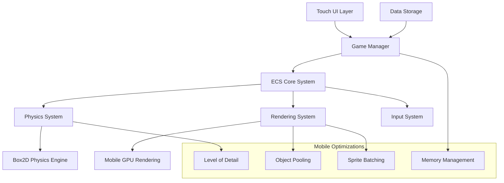

# Design Document: Mechanical Simulation Game

## Overview

The Mechanical Simulation Game is a lightweight 2D mobile application that enables players to create and experiment with mechanical systems using virtual components. The game provides an intuitive touch-based interface for building complex mechanisms from simple parts like gears, belts, levers, and planks, with realistic physics simulation optimized for mobile devices.

The design prioritizes performance and battery efficiency while maintaining engaging gameplay through simplified but accurate mechanical physics. The architecture uses an Entity-Component-System (ECS) pattern for optimal mobile performance, with Box2D as the underlying physics engine configured for lightweight operation.

## Architecture

### High-Level Architecture

The game follows a layered architecture optimized for mobile devices:



### Core Systems

**Entity-Component-System (ECS) Architecture**
- **Entities**: Lightweight identifiers for game objects (components, connections, UI elements)
- **Components**: Data containers (Transform, Physics Body, Renderable, Mechanical Properties)
- **Systems**: Logic processors that operate on component data in batches for cache efficiency

**Physics System**
- Lightweight wrapper around Box2D optimized for mobile performance
- Custom joint implementations for mechanical connections (gears, belts, levers)
- Simplified collision detection with reduced precision for better performance
- Automatic complexity reduction when frame rate drops below target

**Rendering System**
- Sprite-based 2D rendering with batching for minimal draw calls
- Level-of-detail system that reduces visual complexity at high zoom-out levels
- Efficient animation system for rotating gears and moving belts
- Mobile GPU-optimized shaders for simple geometric shapes

## Components and Interfaces

### Core Components

**Transform Component**
```typescript
interface TransformComponent {
  position: Vector2;
  rotation: number;
  scale: Vector2;
  isDirty: boolean;
}
```

**Physics Body Component**
```typescript
interface PhysicsBodyComponent {
  bodyId: Box2DBodyId;
  bodyType: BodyType; // Static, Kinematic, Dynamic
  mass: number;
  inertia: number;
  isSimulated: boolean;
}
```

**Mechanical Component**
```typescript
interface MechanicalComponent {
  componentType: MechanicalType; // Gear, Belt, Lever, Plank, Motor, Anchor
  properties: MechanicalProperties;
  connectionPoints: ConnectionPoint[];
  isActive: boolean;
}

interface MechanicalProperties {
  // Gear-specific
  radius?: number;
  toothCount?: number;
  
  // Belt-specific
  length?: number;
  tension?: number;
  
  // Lever-specific
  fulcrumPosition?: number;
  leverLength?: number;
  
  // Motor-specific
  torque?: number;
  speed?: number;
}
```

**Connection Component**
```typescript
interface ConnectionComponent {
  fromEntity: EntityId;
  toEntity: EntityId;
  connectionType: ConnectionType; // GearMesh, Belt, Joint, Rigid
  jointId?: Box2DJointId;
  isActive: boolean;
}
```

**Renderable Component**
```typescript
interface RenderableComponent {
  spriteId: string;
  color: Color;
  layer: number;
  isVisible: boolean;
  animationState?: AnimationState;
}
```

### System Interfaces

**Physics System Interface**
```typescript
interface IPhysicsSystem {
  createBody(entity: EntityId, bodyDef: BodyDefinition): void;
  createJoint(connectionEntity: EntityId, jointDef: JointDefinition): void;
  step(deltaTime: number): void;
  setSimulationSpeed(speed: number): void;
  pauseSimulation(): void;
  resumeSimulation(): void;
  getBodyTransform(entity: EntityId): Transform;
}
```

**Input System Interface**
```typescript
interface IInputSystem {
  onTouchStart(position: Vector2): void;
  onTouchMove(position: Vector2): void;
  onTouchEnd(position: Vector2): void;
  onPinchZoom(scale: number, center: Vector2): void;
  onTwoFingerPan(delta: Vector2): void;
  registerTouchHandler(handler: TouchHandler): void;
}
```

**Rendering System Interface**
```typescript
interface IRenderingSystem {
  render(deltaTime: number): void;
  setCamera(position: Vector2, zoom: number): void;
  createSprite(entity: EntityId, spriteData: SpriteData): void;
  updateSprite(entity: EntityId, transform: Transform): void;
  setBatchingEnabled(enabled: boolean): void;
}
```

## Data Models

### Core Data Structures

**Workspace Data Model**
```typescript
interface WorkspaceData {
  entities: Map<EntityId, Entity>;
  components: ComponentStorage;
  metadata: WorkspaceMetadata;
  version: number;
}

interface WorkspaceMetadata {
  name: string;
  createdDate: Date;
  lastModified: Date;
  cameraPosition: Vector2;
  cameraZoom: number;
}
```

**Component Storage**
```typescript
interface ComponentStorage {
  transforms: Map<EntityId, TransformComponent>;
  physicsBodies: Map<EntityId, PhysicsBodyComponent>;
  mechanicals: Map<EntityId, MechanicalComponent>;
  connections: Map<EntityId, ConnectionComponent>;
  renderables: Map<EntityId, RenderableComponent>;
}
```

**Mechanical Component Library**
```typescript
interface ComponentLibrary {
  gears: GearDefinition[];
  belts: BeltDefinition[];
  levers: LeverDefinition[];
  planks: PlankDefinition[];
  motors: MotorDefinition[];
  anchors: AnchorDefinition[];
}

interface GearDefinition {
  id: string;
  name: string;
  radius: number;
  toothCount: number;
  mass: number;
  spriteId: string;
}
```

### Physics Integration Data

**Box2D Integration Models**
```typescript
interface Box2DBodyDefinition {
  type: b2BodyType;
  position: b2Vec2;
  angle: number;
  linearDamping: number;
  angularDamping: number;
  fixedRotation: boolean;
}

interface Box2DJointDefinition {
  type: JointType; // Revolute, Prismatic, Distance, Gear, Pulley
  bodyA: b2BodyId;
  bodyB: b2BodyId;
  anchorA: b2Vec2;
  anchorB: b2Vec2;
  enableLimit: boolean;
  enableMotor: boolean;
  motorSpeed?: number;
  maxMotorTorque?: number;
}
```

### Serialization Models

**Save Data Format**
```typescript
interface SaveData {
  version: string;
  workspace: SerializedWorkspace;
  checksum: string;
}

interface SerializedWorkspace {
  entities: SerializedEntity[];
  connections: SerializedConnection[];
  metadata: WorkspaceMetadata;
}

interface SerializedEntity {
  id: string;
  type: string;
  transform: SerializedTransform;
  mechanical: SerializedMechanical;
  renderable: SerializedRenderable;
}
```

## Correctness Properties

*A property is a characteristic or behavior that should hold true across all valid executions of a system—essentially, a formal statement about what the system should do. Properties serve as the bridge between human-readable specifications and machine-verifiable correctness guarantees.*

Based on the prework analysis of acceptance criteria, the following properties validate the core mechanical simulation behaviors:

**Property 1: Touch Interaction Feedback**
*For any* component in the palette or workspace, when touched, the system should provide appropriate visual feedback (highlighting for palette components, selection indicators for workspace components)
**Validates: Requirements 1.1, 1.4**

**Property 2: Component Placement Validation**
*For any* valid workspace location and selected component, placing the component should result in the component appearing at that location
**Validates: Requirements 1.2**

**Property 3: Invalid Placement Rejection**
*For any* invalid workspace location, attempting to place a component should be rejected and the workspace should remain unchanged
**Validates: Requirements 1.3**

**Property 4: Context Menu Activation**
*For any* component in the workspace, long-press gestures should trigger context menus with appropriate options
**Validates: Requirements 1.5**

**Property 5: Connection Establishment**
*For any* pair of compatible components, creating a connection should result in both a logical connection and visual representation
**Validates: Requirements 2.1, 2.4**

**Property 6: Force Transmission**
*For any* connected mechanical system, applying a force to one component should result in appropriate force transmission to connected components
**Validates: Requirements 2.2, 3.2**

**Property 7: Incompatible Connection Rejection**
*For any* pair of incompatible components, attempting to create a connection should be rejected and no connection should be established
**Validates: Requirements 2.3**

**Property 8: Gear Ratio Mechanics**
*For any* pair of meshed gears, the rotational speed ratio should be inversely proportional to the gear radius ratio
**Validates: Requirements 2.5, 3.3**

**Property 9: Belt Mechanics**
*For any* belt connecting two pulleys, the linear speed of the belt should be equal at both pulley contact points
**Validates: Requirements 3.4**

**Property 10: Lever Mechanics**
*For any* lever system, the mechanical advantage should equal the ratio of effort arm to load arm
**Validates: Requirements 3.5**

**Property 11: Simulation State Control**
*For any* workspace, play should start simulation with component updates, pause should preserve current state, and stop should reset to initial positions
**Validates: Requirements 4.1, 4.2, 4.3, 4.5**

**Property 12: Simulation Speed Control**
*For any* simulation speed setting, changing the speed should proportionally affect the rate of physics calculations
**Validates: Requirements 4.4**

**Property 13: Workspace View Transformation**
*For any* zoom or pan operation, the workspace view should change while maintaining component proportions and relative positions
**Validates: Requirements 6.1, 6.2**

**Property 14: Clear Workspace Confirmation**
*For any* workspace with components, the clear action should show confirmation before removing components
**Validates: Requirements 6.5**

**Property 15: App Lifecycle Management**
*For any* app backgrounding event, the simulation should pause and resource usage should be reduced
**Validates: Requirements 10.3**

**Property 16: Corrupted Data Handling**
*For any* corrupted save file, the loading process should handle the error gracefully and provide user-friendly error messages
**Validates: Requirements 11.3**

**Property 17: Auto-Save Functionality**
*For any* workspace changes, the system should automatically save the workspace state at appropriate intervals
**Validates: Requirements 11.4**

**Property 18: Data Persistence Round-Trip**
*For any* valid workspace state, saving then loading should produce an equivalent workspace with all components, connections, and properties preserved
**Validates: Requirements 6.3, 6.4, 11.1, 11.2, 11.5**

<function_calls>
<invoke name="prework">
<parameter name="featureName">mechanical-simulation-game

## Error Handling

### Physics Simulation Errors

**Numerical Instability**
- Detect when physics calculations produce NaN or infinite values
- Automatically reset affected components to stable states
- Log instability events for debugging purposes
- Implement fallback simplified physics for unstable configurations

**Performance Degradation**
- Monitor frame rate and automatically reduce simulation complexity when performance drops
- Implement level-of-detail system that simplifies distant or small components
- Provide user notification when automatic optimizations are applied
- Allow manual override of performance optimizations

**Invalid Mechanical Configurations**
- Detect impossible mechanical configurations (e.g., gear ratios that would cause infinite speeds)
- Prevent creation of mechanically impossible systems
- Provide user feedback explaining why certain configurations are invalid
- Suggest alternative valid configurations when possible

### Data Persistence Errors

**Save File Corruption**
- Implement checksum validation for all save files
- Provide graceful degradation when save files are partially corrupted
- Maintain backup saves to prevent total data loss
- Display clear error messages explaining data recovery options

**Storage Space Issues**
- Monitor available device storage before saving
- Implement data compression to minimize storage requirements
- Provide user notification when storage space is low
- Offer options to delete old saves or export data

**Version Compatibility**
- Maintain backward compatibility with previous save file versions
- Implement migration system for upgrading old save formats
- Handle gracefully when save files are from newer versions
- Provide clear messaging about version compatibility issues

### User Interface Errors

**Touch Input Errors**
- Handle accidental touches and provide undo functionality
- Implement touch debouncing to prevent multiple rapid inputs
- Provide visual feedback for all touch interactions
- Handle edge cases like simultaneous multi-touch inputs

**Memory Pressure**
- Monitor memory usage and implement garbage collection strategies
- Reduce visual quality when memory pressure is detected
- Provide user notification when memory optimizations are applied
- Implement emergency memory cleanup procedures

## Testing Strategy

### Dual Testing Approach

The testing strategy employs both unit testing and property-based testing to ensure comprehensive coverage:

**Unit Tests**: Focus on specific examples, edge cases, and integration points between components. Unit tests validate concrete scenarios and ensure proper error handling.

**Property Tests**: Verify universal properties that should hold across all inputs using randomized test data. Property tests provide comprehensive input coverage and catch edge cases that might be missed by example-based tests.

### Property-Based Testing Configuration

**Testing Framework**: Use a property-based testing library appropriate for the chosen implementation language (e.g., QuickCheck for Haskell, Hypothesis for Python, fast-check for JavaScript/TypeScript).

**Test Configuration**:
- Minimum 100 iterations per property test to ensure adequate randomization coverage
- Each property test must reference its corresponding design document property
- Tag format: **Feature: mechanical-simulation-game, Property {number}: {property_text}**

**Test Data Generation**:
- Generate random component configurations within valid mechanical constraints
- Create random workspace layouts with varying complexity
- Generate edge cases like very small/large components, extreme gear ratios, and boundary conditions
- Test with various device capabilities and performance constraints

### Unit Testing Focus Areas

**Component Integration**:
- Test proper initialization and cleanup of ECS components
- Verify correct Box2D body and joint creation
- Test component lifecycle management (creation, modification, destruction)

**Physics Integration**:
- Test Box2D wrapper functionality with known mechanical configurations
- Verify correct joint constraint setup for different mechanical connections
- Test physics simulation step integration with ECS systems

**Mobile-Specific Testing**:
- Test touch input handling across different device screen sizes
- Verify performance optimizations under various load conditions
- Test app lifecycle events (backgrounding, foregrounding, memory warnings)

**Error Conditions**:
- Test graceful handling of corrupted save files
- Verify proper error messaging for invalid user actions
- Test recovery from physics simulation instabilities

### Performance Testing

**Frame Rate Validation**:
- Measure frame rates under various simulation complexities
- Test automatic performance optimization triggers
- Verify consistent performance across different mobile devices

**Memory Usage Monitoring**:
- Track memory consumption during extended play sessions
- Test memory cleanup during component destruction
- Verify no memory leaks in long-running simulations

**Battery Usage Testing**:
- Monitor power consumption during active simulation
- Test battery optimization features (reduced complexity, background pause)
- Verify efficient rendering pipeline performance

Each correctness property from the design document must be implemented as a single property-based test, ensuring that the formal specifications are directly validated through automated testing.