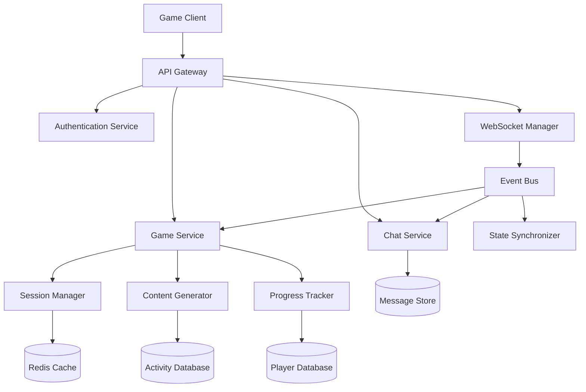
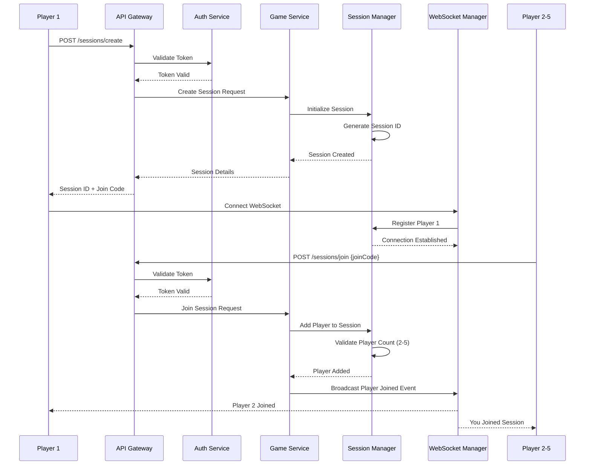
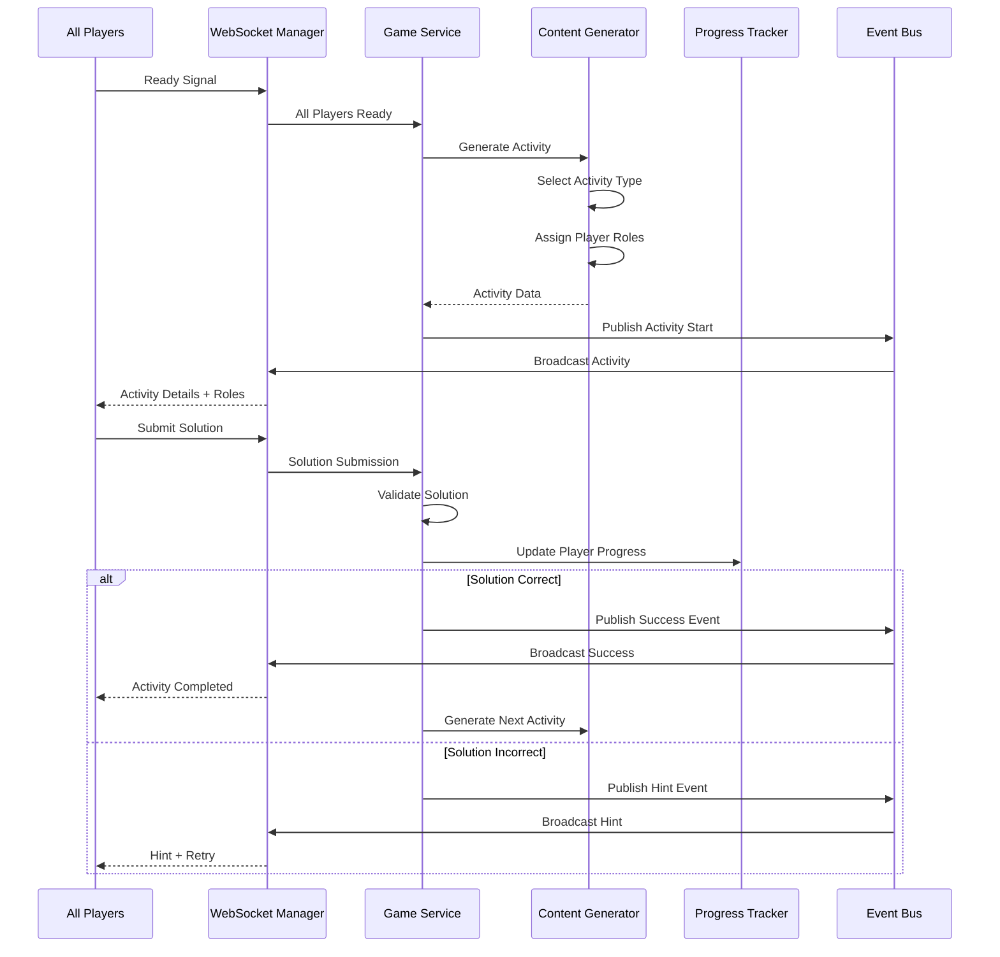
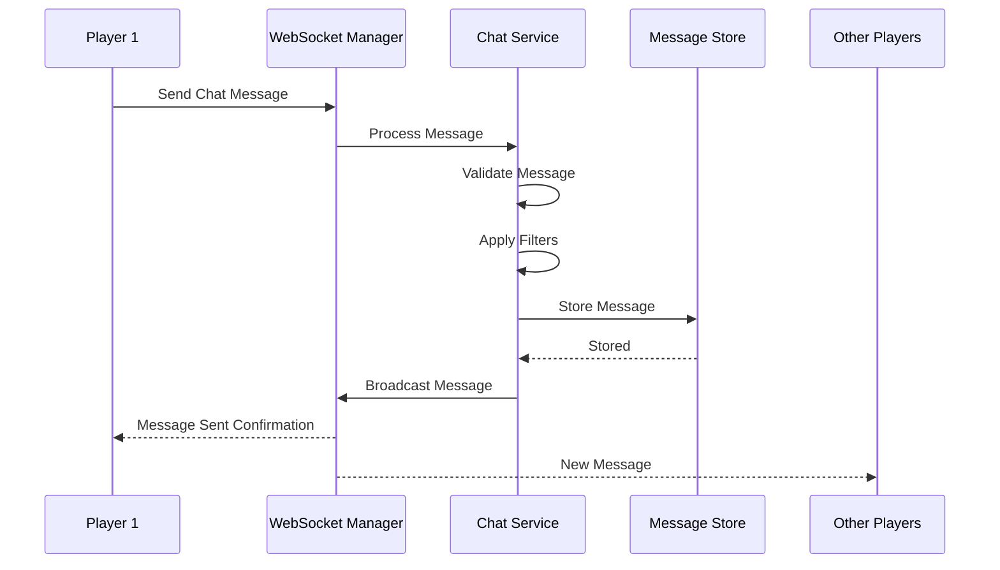

# Design Document: Multiplayer Puzzle Adventure Game

## Overview

This system provides a collaborative multiplayer gaming platform where 2-5 players work together to solve puzzles and progress through adventure scenarios. The platform dynamically generates game activities that test both technical knowledge and soft skills, requiring real-time collaboration and communication. Players interact through an integrated chat system while navigating through puzzle challenges that adapt to team performance and individual contributions.

The architecture supports real-time multiplayer synchronization, dynamic content generation, player progression tracking, and collaborative puzzle mechanics. The system ensures fair gameplay through role-based puzzle distribution and validates team-based solutions before allowing progression.

## Architecture




## Sequence Diagrams

### Game Session Creation and Player Join Flow



### Puzzle Activity Flow




### Real-Time Chat Flow



## Components and Interfaces

### Component 1: Authentication Service

**Purpose**: Manages player authentication, authorization, and session tokens

**Interface**:
```pascal
INTERFACE AuthenticationService
  PROCEDURE authenticatePlayer(credentials)
    INPUT: credentials (username, password)
    OUTPUT: AuthResult (token, playerId, profile)
  
  PROCEDURE validateToken(token)
    INPUT: token (String)
    OUTPUT: ValidationResult (valid, playerId)
  
  PROCEDURE refreshToken(oldToken)
    INPUT: oldToken (String)
    OUTPUT: AuthResult (newToken, playerId)
END INTERFACE
```

**Responsibilities**:
- Authenticate players using credentials
- Generate and validate JWT tokens
- Manage session expiration and refresh
- Enforce rate limiting on authentication attempts

### Component 2: Game Service

**Purpose**: Core game logic orchestration, activity management, and game state coordination

**Interface**:
```pascal
INTERFACE GameService
  PROCEDURE createSession(hostPlayerId, settings)
    INPUT: hostPlayerId (UUID), settings (GameSettings)
    OUTPUT: SessionResult (sessionId, joinCode)
  
  PROCEDURE joinSession(playerId, joinCode)
    INPUT: playerId (UUID), joinCode (String)
    OUTPUT: JoinResult (success, sessionData)
  
  PROCEDURE startGame(sessionId)
    INPUT: sessionId (UUID)
    OUTPUT: GameStartResult (success, initialActivity)
  
  PROCEDURE submitSolution(sessionId, playerId, solution)
    INPUT: sessionId (UUID), playerId (UUID), solution (SolutionData)
    OUTPUT: ValidationResult (correct, feedback, nextActivity)
  
  PROCEDURE endSession(sessionId, reason)
    INPUT: sessionId (UUID), reason (String)
    OUTPUT: EndResult (success, finalStats)
END INTERFACE
```

**Responsibilities**:
- Manage game session lifecycle (create, start, end)
- Coordinate between content generation and player actions
- Validate player solutions and puzzle completions
- Enforce game rules (player count, turn order, collaboration requirements)
- Trigger progression to next activities


### Component 3: Session Manager

**Purpose**: Manages active game sessions, player connections, and session state

**Interface**:
```pascal
INTERFACE SessionManager
  PROCEDURE initializeSession(hostPlayerId, settings)
    INPUT: hostPlayerId (UUID), settings (GameSettings)
    OUTPUT: Session (sessionId, joinCode, state)
  
  PROCEDURE addPlayer(sessionId, playerId)
    INPUT: sessionId (UUID), playerId (UUID)
    OUTPUT: AddPlayerResult (success, playerCount)
  
  PROCEDURE removePlayer(sessionId, playerId)
    INPUT: sessionId (UUID), playerId (UUID)
    OUTPUT: RemovePlayerResult (success, remainingPlayers)
  
  PROCEDURE getSessionState(sessionId)
    INPUT: sessionId (UUID)
    OUTPUT: SessionState (players, currentActivity, progress)
  
  PROCEDURE updateSessionState(sessionId, stateUpdate)
    INPUT: sessionId (UUID), stateUpdate (StateData)
    OUTPUT: UpdateResult (success, newState)
END INTERFACE
```

**Responsibilities**:
- Create and destroy game sessions
- Track active players in each session
- Maintain session state in Redis cache
- Validate player count constraints (2-5 players)
- Generate unique join codes
- Handle player disconnections and reconnections

### Component 4: Content Generator

**Purpose**: Dynamically generates game activities, puzzles, and challenges based on player skills and progress

**Interface**:
```pascal
INTERFACE ContentGenerator
  PROCEDURE generateActivity(sessionId, playerProfiles, difficulty)
    INPUT: sessionId (UUID), playerProfiles (Array of PlayerProfile), difficulty (Integer)
    OUTPUT: Activity (activityId, type, content, roles)
  
  PROCEDURE getActivityTypes()
    INPUT: None
    OUTPUT: Array of ActivityType
  
  PROCEDURE assignPlayerRoles(activity, players)
    INPUT: activity (Activity), players (Array of Player)
    OUTPUT: RoleAssignment (Map of playerId to role)
  
  PROCEDURE generateHint(activityId, attemptCount)
    INPUT: activityId (UUID), attemptCount (Integer)
    OUTPUT: Hint (content, level)
END INTERFACE
```

**Responsibilities**:
- Generate diverse activity types (technical puzzles, soft skill challenges, adventure scenarios)
- Adapt difficulty based on team performance
- Assign complementary roles to players
- Create collaborative puzzles requiring multiple players
- Generate progressive hints for stuck teams
- Balance technical and soft skill activities


### Component 5: Chat Service

**Purpose**: Manages real-time chat communication between players in a session

**Interface**:
```pascal
INTERFACE ChatService
  PROCEDURE sendMessage(sessionId, playerId, message)
    INPUT: sessionId (UUID), playerId (UUID), message (String)
    OUTPUT: MessageResult (messageId, timestamp)
  
  PROCEDURE getMessageHistory(sessionId, limit, offset)
    INPUT: sessionId (UUID), limit (Integer), offset (Integer)
    OUTPUT: Array of Message
  
  PROCEDURE filterMessage(message)
    INPUT: message (String)
    OUTPUT: FilterResult (allowed, filteredMessage)
  
  PROCEDURE notifyTyping(sessionId, playerId, isTyping)
    INPUT: sessionId (UUID), playerId (UUID), isTyping (Boolean)
    OUTPUT: NotificationResult (success)
END INTERFACE
```

**Responsibilities**:
- Process and broadcast chat messages to session participants
- Store message history for session replay
- Apply content filtering and moderation
- Handle typing indicators
- Support system messages for game events
- Enforce rate limiting on messages

### Component 6: Progress Tracker

**Purpose**: Tracks individual player progress, team achievements, and skill development

**Interface**:
```pascal
INTERFACE ProgressTracker
  PROCEDURE updatePlayerProgress(playerId, activityId, performance)
    INPUT: playerId (UUID), activityId (UUID), performance (PerformanceData)
    OUTPUT: UpdateResult (success, newStats)
  
  PROCEDURE getPlayerStats(playerId)
    INPUT: playerId (UUID)
    OUTPUT: PlayerStats (technicalScore, softSkillScore, achievements)
  
  PROCEDURE getTeamStats(sessionId)
    INPUT: sessionId (UUID)
    OUTPUT: TeamStats (completedActivities, averageTime, successRate)
  
  PROCEDURE awardAchievement(playerId, achievementId)
    INPUT: playerId (UUID), achievementId (UUID)
    OUTPUT: AchievementResult (success, achievement)
END INTERFACE
```

**Responsibilities**:
- Track individual player performance metrics
- Calculate team collaboration scores
- Award achievements and badges
- Maintain skill progression data
- Generate performance analytics
- Support leaderboards and rankings


### Component 7: WebSocket Manager

**Purpose**: Manages real-time bidirectional communication between clients and server

**Interface**:
```pascal
INTERFACE WebSocketManager
  PROCEDURE connect(playerId, sessionId, token)
    INPUT: playerId (UUID), sessionId (UUID), token (String)
    OUTPUT: ConnectionResult (connectionId, success)
  
  PROCEDURE disconnect(connectionId)
    INPUT: connectionId (UUID)
    OUTPUT: DisconnectResult (success)
  
  PROCEDURE broadcast(sessionId, event, data)
    INPUT: sessionId (UUID), event (String), data (Object)
    OUTPUT: BroadcastResult (recipientCount)
  
  PROCEDURE sendToPlayer(playerId, event, data)
    INPUT: playerId (UUID), event (String), data (Object)
    OUTPUT: SendResult (success)
  
  PROCEDURE handleMessage(connectionId, message)
    INPUT: connectionId (UUID), message (Object)
    OUTPUT: HandleResult (success)
END INTERFACE
```

**Responsibilities**:
- Establish and maintain WebSocket connections
- Route messages between clients and services
- Broadcast events to all session participants
- Handle connection drops and reconnection logic
- Implement heartbeat/ping-pong for connection health
- Queue messages for temporarily disconnected players

### Component 8: State Synchronizer

**Purpose**: Ensures consistent game state across all connected clients

**Interface**:
```pascal
INTERFACE StateSynchronizer
  PROCEDURE syncState(sessionId, stateSnapshot)
    INPUT: sessionId (UUID), stateSnapshot (GameState)
    OUTPUT: SyncResult (success, version)
  
  PROCEDURE resolveConflict(sessionId, conflictingStates)
    INPUT: sessionId (UUID), conflictingStates (Array of GameState)
    OUTPUT: ResolvedState (canonicalState)
  
  PROCEDURE getStateVersion(sessionId)
    INPUT: sessionId (UUID)
    OUTPUT: VersionInfo (version, timestamp)
  
  PROCEDURE rollbackState(sessionId, targetVersion)
    INPUT: sessionId (UUID), targetVersion (Integer)
    OUTPUT: RollbackResult (success, restoredState)
END INTERFACE
```

**Responsibilities**:
- Maintain authoritative game state
- Detect and resolve state conflicts
- Version game state for rollback capability
- Synchronize state updates across all clients
- Handle late-joining players with state catch-up
- Implement optimistic updates with server reconciliation


## Data Models

### Model 1: Player

```pascal
STRUCTURE Player
  id: UUID
  username: String
  email: String
  passwordHash: String
  profile: PlayerProfile
  createdAt: Timestamp
  lastLoginAt: Timestamp
END STRUCTURE

STRUCTURE PlayerProfile
  displayName: String
  avatarUrl: String
  technicalSkillLevel: Integer (1-10)
  softSkillLevel: Integer (1-10)
  preferredRoles: Array of String
  achievements: Array of UUID
  totalGamesPlayed: Integer
  totalGamesWon: Integer
END STRUCTURE
```

**Validation Rules**:
- username must be unique, 3-20 characters, alphanumeric with underscores
- email must be valid email format
- passwordHash must be bcrypt hashed
- technicalSkillLevel and softSkillLevel must be between 1 and 10
- displayName must be 1-30 characters

### Model 2: GameSession

```pascal
STRUCTURE GameSession
  id: UUID
  joinCode: String
  hostPlayerId: UUID
  players: Array of SessionPlayer
  state: SessionState
  settings: GameSettings
  currentActivity: Activity
  activityHistory: Array of UUID
  createdAt: Timestamp
  startedAt: Timestamp
  endedAt: Timestamp
END STRUCTURE

STRUCTURE SessionPlayer
  playerId: UUID
  joinedAt: Timestamp
  isConnected: Boolean
  currentRole: String
  score: Integer
END STRUCTURE

ENUMERATION SessionState
  WAITING
  READY
  IN_PROGRESS
  PAUSED
  COMPLETED
  ABANDONED
END ENUMERATION

STRUCTURE GameSettings
  minPlayers: Integer (default: 2)
  maxPlayers: Integer (default: 5)
  difficulty: Integer (1-5)
  activityTypes: Array of String
  timeLimit: Integer (seconds, optional)
  allowHints: Boolean
END STRUCTURE
```

**Validation Rules**:
- joinCode must be unique, 6 characters, alphanumeric uppercase
- players array must contain 2-5 SessionPlayer objects
- hostPlayerId must be in players array
- difficulty must be between 1 and 5
- timeLimit must be positive integer or null


### Model 3: Activity

```pascal
STRUCTURE Activity
  id: UUID
  type: ActivityType
  title: String
  description: String
  difficulty: Integer (1-5)
  requiredPlayers: Integer (2-5)
  roles: Array of PlayerRole
  content: ActivityContent
  solution: SolutionData
  hints: Array of Hint
  timeEstimate: Integer (seconds)
  skillsRequired: SkillRequirements
  createdAt: Timestamp
END STRUCTURE

ENUMERATION ActivityType
  TECHNICAL_PUZZLE
  CODE_CHALLENGE
  SYSTEM_DESIGN
  DEBUGGING_QUEST
  COMMUNICATION_CHALLENGE
  NEGOTIATION_SCENARIO
  TEAM_COORDINATION
  RESOURCE_MANAGEMENT
  LOGIC_PUZZLE
  ADVENTURE_SCENARIO
END ENUMERATION

STRUCTURE PlayerRole
  roleId: String
  name: String
  description: String
  capabilities: Array of String
  restrictions: Array of String
  assignedPlayerId: UUID (optional)
END STRUCTURE

STRUCTURE ActivityContent
  scenario: String
  objectives: Array of String
  resources: Map of String to Object
  constraints: Array of String
  visualAssets: Array of String (URLs)
END STRUCTURE

STRUCTURE SolutionData
  type: String (TEXT, CODE, CHOICE, SEQUENCE, COLLABORATIVE)
  expectedAnswer: Object
  validationRules: Array of ValidationRule
  requiresAllPlayers: Boolean
END STRUCTURE

STRUCTURE Hint
  level: Integer (1-3)
  content: String
  unlockAfterAttempts: Integer
END STRUCTURE

STRUCTURE SkillRequirements
  technicalSkills: Array of String
  softSkills: Array of String
  minimumSkillLevel: Integer
END STRUCTURE
```

**Validation Rules**:
- type must be valid ActivityType enumeration value
- difficulty must be between 1 and 5
- requiredPlayers must be between 2 and 5
- roles array length must equal requiredPlayers
- hints must be ordered by level (1, 2, 3)
- timeEstimate must be positive integer


### Model 4: ChatMessage

```pascal
STRUCTURE ChatMessage
  id: UUID
  sessionId: UUID
  playerId: UUID (null for system messages)
  content: String
  type: MessageType
  timestamp: Timestamp
  isFiltered: Boolean
  metadata: Map of String to String
END STRUCTURE

ENUMERATION MessageType
  PLAYER_MESSAGE
  SYSTEM_MESSAGE
  ACTIVITY_HINT
  ACHIEVEMENT_NOTIFICATION
  PLAYER_JOINED
  PLAYER_LEFT
END ENUMERATION
```

**Validation Rules**:
- content must be 1-500 characters
- playerId must be null only when type is SYSTEM_MESSAGE or notification types
- timestamp must be valid ISO 8601 format
- type must be valid MessageType enumeration value

### Model 5: PlayerProgress

```pascal
STRUCTURE PlayerProgress
  playerId: UUID
  technicalScore: Integer
  softSkillScore: Integer
  activitiesCompleted: Integer
  activitiesFailed: Integer
  totalPlayTime: Integer (seconds)
  skillBreakdown: SkillBreakdown
  achievements: Array of Achievement
  lastUpdated: Timestamp
END STRUCTURE

STRUCTURE SkillBreakdown
  coding: Integer (0-100)
  systemDesign: Integer (0-100)
  debugging: Integer (0-100)
  communication: Integer (0-100)
  leadership: Integer (0-100)
  problemSolving: Integer (0-100)
  collaboration: Integer (0-100)
END STRUCTURE

STRUCTURE Achievement
  id: UUID
  name: String
  description: String
  iconUrl: String
  unlockedAt: Timestamp
  rarity: String (COMMON, RARE, EPIC, LEGENDARY)
END STRUCTURE
```

**Validation Rules**:
- technicalScore and softSkillScore must be non-negative integers
- all SkillBreakdown values must be between 0 and 100
- totalPlayTime must be non-negative integer
- rarity must be valid enumeration value


### Model 6: GameEvent

```pascal
STRUCTURE GameEvent
  id: UUID
  sessionId: UUID
  eventType: EventType
  playerId: UUID (optional)
  timestamp: Timestamp
  data: Object
  processed: Boolean
END STRUCTURE

ENUMERATION EventType
  SESSION_CREATED
  PLAYER_JOINED
  PLAYER_LEFT
  GAME_STARTED
  ACTIVITY_STARTED
  SOLUTION_SUBMITTED
  ACTIVITY_COMPLETED
  ACTIVITY_FAILED
  HINT_REQUESTED
  CHAT_MESSAGE_SENT
  GAME_ENDED
  STATE_SYNCHRONIZED
END ENUMERATION
```

**Validation Rules**:
- eventType must be valid EventType enumeration value
- timestamp must be valid ISO 8601 format
- data must be valid JSON object
- playerId can be null for system-level events

## Correctness Properties

### Property 1: Player Count Constraint
```pascal
PROPERTY PlayerCountValid
  FOR ALL sessions IN GameSession:
    sessions.players.length >= 2 AND sessions.players.length <= 5
END PROPERTY
```

### Property 2: Unique Join Codes
```pascal
PROPERTY UniqueJoinCodes
  FOR ALL session1, session2 IN GameSession:
    IF session1.id != session2.id AND 
       session1.state IN [WAITING, READY, IN_PROGRESS] AND
       session2.state IN [WAITING, READY, IN_PROGRESS]
    THEN session1.joinCode != session2.joinCode
END PROPERTY
```

### Property 3: Activity Role Assignment
```pascal
PROPERTY RolesAssignedCorrectly
  FOR ALL activities IN Activity:
    activities.roles.length = activities.requiredPlayers AND
    FOR ALL role IN activities.roles:
      role.assignedPlayerId IS NULL OR 
      role.assignedPlayerId IN activities.session.players
END PROPERTY
```

### Property 4: Chat Message Ordering
```pascal
PROPERTY MessageOrderPreserved
  FOR ALL msg1, msg2 IN ChatMessage WHERE msg1.sessionId = msg2.sessionId:
    IF msg1.timestamp < msg2.timestamp
    THEN msg1 appears before msg2 in message history
END PROPERTY
```

### Property 5: State Synchronization Consistency
```pascal
PROPERTY StateSynchronized
  FOR ALL players IN session.players WHERE player.isConnected = true:
    player.localState.version = session.authoritative.state.version
    WITHIN synchronization_timeout
END PROPERTY
```

### Property 6: Progress Tracking Accuracy
```pascal
PROPERTY ProgressAccurate
  FOR ALL players IN Player:
    player.profile.totalGamesPlayed = 
      COUNT(sessions WHERE player.id IN sessions.players AND 
            sessions.state = COMPLETED)
END PROPERTY
```


## Error Handling

### Error Scenario 1: Player Disconnection During Active Game

**Condition**: Player's WebSocket connection drops while game is in progress
**Response**: 
- System marks player as disconnected but maintains their session slot
- Other players receive notification of disconnection
- Game pauses if activity requires all players
- Disconnected player has 60-second grace period to reconnect
**Recovery**: 
- If player reconnects within grace period, sync current game state and resume
- If grace period expires, remaining players vote to continue with AI substitute or end session
- Player's progress is saved regardless of reconnection outcome

### Error Scenario 2: Invalid Solution Submission

**Condition**: Player submits solution that doesn't match expected format or validation rules
**Response**:
- System validates solution against activity's validation rules
- Returns detailed error message indicating what's invalid
- Does not count as failed attempt if format is wrong
- Logs validation failure for analytics
**Recovery**:
- Player can resubmit with corrected format
- System provides format hints if multiple format errors occur
- Activity remains in current state

### Error Scenario 3: Session Join Code Collision

**Condition**: Generated join code already exists for an active session
**Response**:
- System detects collision during session creation
- Regenerates new join code using cryptographically secure random generator
- Retries up to 5 times with exponential backoff
- If all retries fail, returns error to host
**Recovery**:
- Host can retry session creation
- System logs collision rate for monitoring
- If collision rate exceeds threshold, increase join code length

### Error Scenario 4: Content Generator Failure

**Condition**: Content Generator cannot produce valid activity due to constraints or service failure
**Response**:
- System catches generation exception
- Falls back to pre-generated activity pool matching session criteria
- Logs generation failure with context for debugging
- Notifies monitoring system of degraded service
**Recovery**:
- Use fallback activity from pool
- If pool is exhausted, gracefully end session with explanation
- Players receive partial credit for completed activities
- System attempts to restore Content Generator service

### Error Scenario 5: State Synchronization Conflict

**Condition**: Multiple players submit conflicting state updates simultaneously
**Response**:
- State Synchronizer detects conflict through version mismatch
- Applies server-authoritative resolution using timestamp ordering
- Rejects conflicting updates and sends canonical state to all clients
- Logs conflict for analysis
**Recovery**:
- Clients receive state correction and update local state
- Conflicting actions are rolled back on client side
- Players can retry actions based on corrected state
- System monitors conflict rate to detect network issues


### Error Scenario 6: Chat Message Rate Limiting

**Condition**: Player exceeds maximum message rate (e.g., 10 messages per 10 seconds)
**Response**:
- System rejects message with rate limit error
- Returns time until rate limit resets
- Does not broadcast rejected message
- Logs rate limit violation
**Recovery**:
- Player must wait for rate limit window to reset
- Client UI displays cooldown timer
- Queued messages can be sent after cooldown
- Repeated violations may trigger temporary chat suspension

### Error Scenario 7: Database Connection Loss

**Condition**: Connection to Player Database or Activity Database is lost
**Response**:
- System detects connection failure through health checks
- Switches to read-only mode using Redis cache
- New sessions cannot be created but active sessions continue
- Returns service degraded status to clients
**Recovery**:
- Connection pool attempts automatic reconnection with exponential backoff
- Once connection restored, flush cached writes to database
- Verify data consistency after reconnection
- Resume normal operations and clear degraded status

## Testing Strategy

### Unit Testing Approach

Each component will have comprehensive unit tests covering:

- **Authentication Service**: Token generation, validation, expiration, refresh flows
- **Game Service**: Session lifecycle, solution validation, game rule enforcement
- **Session Manager**: Player add/remove, state transitions, join code generation
- **Content Generator**: Activity generation for all types, role assignment, difficulty scaling
- **Chat Service**: Message processing, filtering, rate limiting, history retrieval
- **Progress Tracker**: Score calculation, achievement unlocking, stat aggregation
- **WebSocket Manager**: Connection handling, message routing, broadcast logic
- **State Synchronizer**: Conflict detection, resolution algorithms, version management

Test coverage target: 85% code coverage minimum

Key test scenarios:
- Boundary conditions (exactly 2 players, exactly 5 players)
- Invalid inputs and error paths
- Concurrent operations and race conditions
- State transitions and lifecycle management


### Property-Based Testing Approach

Property-based tests will validate system invariants across randomly generated inputs:

**Property Test Library**: fast-check (for JavaScript/TypeScript) or Hypothesis (for Python)

**Key Properties to Test**:

1. **Session Integrity**: For any sequence of player join/leave operations, player count remains within [2, 5] or session ends
2. **Join Code Uniqueness**: Generated join codes are always unique across active sessions
3. **State Consistency**: After any sequence of game events, all connected clients converge to same state
4. **Message Ordering**: Chat messages are always delivered in timestamp order
5. **Progress Monotonicity**: Player scores and statistics only increase, never decrease
6. **Activity Validity**: Generated activities always have valid role assignments and solvable solutions
7. **Idempotency**: Repeated identical requests produce same result without side effects

**Test Execution**:
- Run 1000+ random test cases per property
- Use shrinking to find minimal failing cases
- Integrate into CI/CD pipeline
- Generate test reports with counterexamples

### Integration Testing Approach

Integration tests will validate component interactions:

**Test Scenarios**:

1. **End-to-End Game Flow**: Create session → players join → start game → complete activities → end session
2. **Real-Time Communication**: WebSocket connections → chat messages → game events → state updates
3. **Multi-Player Coordination**: Simultaneous player actions → conflict resolution → state synchronization
4. **Persistence Layer**: Database writes → cache updates → data retrieval → consistency verification
5. **Service Degradation**: Simulate service failures → verify fallback behavior → recovery validation

**Test Environment**:
- Use Docker containers for isolated test environments
- Mock external dependencies (email service, payment gateway)
- Use test databases with known seed data
- Simulate network latency and packet loss

**Performance Testing**:
- Load test with 100 concurrent sessions (500 players)
- Stress test WebSocket connections (1000+ concurrent connections)
- Measure response times for critical paths (< 100ms for game actions)
- Test database query performance under load


## Performance Considerations

### Real-Time Latency Requirements

- **WebSocket Message Delivery**: < 50ms for same-region players, < 150ms cross-region
- **Game Action Response**: < 100ms from player action to state update broadcast
- **Chat Message Delivery**: < 100ms from send to all recipients
- **Activity Generation**: < 500ms for dynamic content generation
- **State Synchronization**: < 200ms for full state sync to new/reconnecting player

### Scalability Targets

- **Concurrent Sessions**: Support 10,000 concurrent game sessions
- **Active Players**: Support 50,000 concurrent connected players
- **WebSocket Connections**: Handle 50,000+ persistent connections
- **Message Throughput**: Process 100,000 messages per second across all sessions
- **Database Operations**: Handle 10,000 reads/writes per second

### Optimization Strategies

**Caching**:
- Use Redis for session state (TTL: session duration + 1 hour)
- Cache player profiles (TTL: 15 minutes)
- Cache activity templates (TTL: 1 hour)
- Cache leaderboards (TTL: 5 minutes)

**Database Optimization**:
- Index on sessionId, playerId, timestamp fields
- Partition message tables by date
- Use read replicas for analytics queries
- Implement connection pooling (min: 10, max: 100 connections)

**WebSocket Optimization**:
- Use message batching for non-critical updates
- Implement binary protocol for large payloads
- Use compression for messages > 1KB
- Implement client-side prediction for immediate feedback

**Content Delivery**:
- CDN for static assets (images, audio, visual elements)
- Lazy load activity content
- Preload next activity during current activity
- Use progressive image loading

### Resource Management

**Memory**:
- Limit session state size to 10MB per session
- Implement LRU cache eviction for inactive sessions
- Monitor memory usage per service instance
- Set heap size limits based on container resources

**CPU**:
- Offload content generation to dedicated worker pool
- Use async/await for I/O operations
- Implement request queuing for rate limiting
- Monitor CPU usage and auto-scale based on thresholds


## Security Considerations

### Authentication & Authorization

**Token Security**:
- Use JWT with RS256 signing algorithm
- Token expiration: 1 hour for access tokens, 7 days for refresh tokens
- Include player ID, session ID, and permissions in token claims
- Rotate signing keys every 90 days
- Implement token revocation list for compromised tokens

**Session Security**:
- Validate player authorization for all session operations
- Verify player is member of session before allowing actions
- Implement rate limiting per player (100 requests per minute)
- Use HTTPS/WSS for all client-server communication

### Data Protection

**Sensitive Data**:
- Hash passwords using bcrypt (cost factor: 12)
- Never log or transmit passwords in plain text
- Encrypt player email addresses at rest
- Sanitize all user inputs before storage
- Implement PII data retention policies (delete after 2 years of inactivity)

**Chat Security**:
- Filter profanity and inappropriate content
- Implement content moderation queue for flagged messages
- Rate limit chat messages (10 per 10 seconds per player)
- Log all chat messages for abuse investigation
- Allow players to report and block other players

### Input Validation

**Client Input**:
- Validate all player inputs against schema
- Sanitize strings to prevent XSS attacks
- Limit string lengths (username: 20, message: 500, etc.)
- Reject malformed JSON payloads
- Validate UUIDs format for all ID fields

**Solution Validation**:
- Validate solution format before processing
- Implement timeout for solution validation (5 seconds max)
- Sandbox code execution for code challenge activities
- Prevent injection attacks in dynamic content

### Network Security

**DDoS Protection**:
- Implement rate limiting at API gateway level
- Use connection throttling for WebSocket connections
- Deploy behind CDN with DDoS protection
- Monitor for abnormal traffic patterns
- Implement IP-based blocking for malicious actors

**API Security**:
- Use API keys for service-to-service communication
- Implement request signing for critical operations
- Validate origin headers for WebSocket connections
- Use CORS policies to restrict client origins
- Implement request size limits (max: 1MB per request)


### Audit & Compliance

**Logging**:
- Log all authentication attempts (success and failure)
- Log all session creation and termination events
- Log all player actions with timestamps
- Log all administrative actions
- Implement log retention policy (90 days for security logs)

**Monitoring**:
- Monitor failed authentication attempts (alert on > 10 failures per minute)
- Monitor unusual player behavior patterns
- Track and alert on data access anomalies
- Implement security incident response procedures

## Dependencies

### External Services

**Authentication**:
- OAuth 2.0 providers (Google, GitHub, Discord) for social login
- Email service (SendGrid, AWS SES) for password reset and notifications

**Infrastructure**:
- Redis (v7.0+) for session state and caching
- PostgreSQL (v14+) or MongoDB (v6.0+) for persistent data storage
- Message queue (RabbitMQ, AWS SQS) for event processing
- CDN (CloudFlare, AWS CloudFront) for static asset delivery

**Monitoring & Observability**:
- Application Performance Monitoring (DataDog, New Relic)
- Log aggregation (ELK Stack, Splunk)
- Error tracking (Sentry, Rollbar)
- Metrics collection (Prometheus, Grafana)

### Libraries & Frameworks

**Backend**:
- WebSocket library (ws, Socket.io, or language-specific implementation)
- JWT library for token management
- Bcrypt for password hashing
- Validation library (Joi, Yup, or language-specific)
- ORM/ODM for database access (Prisma, TypeORM, Mongoose)

**Testing**:
- Unit testing framework (Jest, Mocha, pytest)
- Property-based testing (fast-check, Hypothesis)
- Integration testing (Supertest, Playwright)
- Load testing (k6, Artillery)

**Frontend** (if applicable):
- WebSocket client library
- State management (Redux, Zustand, Pinia)
- UI framework (React, Vue, Svelte)
- Real-time collaboration library

### Third-Party APIs

**Content Generation** (optional):
- AI/ML API for dynamic puzzle generation (OpenAI, Anthropic)
- Code execution sandbox (Judge0, Piston)
- Image generation for visual puzzles (DALL-E, Stable Diffusion)

**Analytics**:
- Player behavior analytics (Mixpanel, Amplitude)
- A/B testing platform (Optimizely, LaunchDarkly)

### Version Requirements

- Node.js 18+ or Python 3.10+ (depending on implementation language)
- Redis 7.0+
- PostgreSQL 14+ or MongoDB 6.0+
- Docker 20+ for containerization
- Kubernetes 1.25+ for orchestration (if using K8s)
