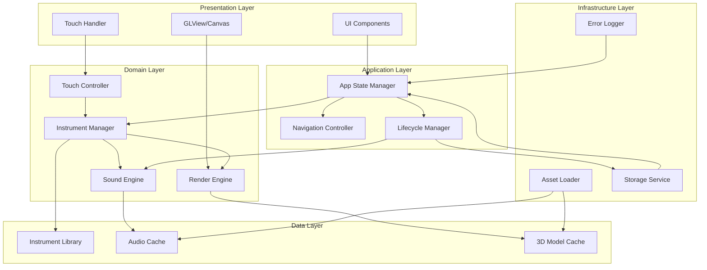

# Design Document: Mobile Musical Instrument Game

## Overview

This document provides the technical design for a mobile musical instrument game that enables users to interact with realistic 3D models of Thai traditional and international instruments through touch controls. The application targets both mobile phones (4-7 inches) and tablets (7-13 inches) running on iOS and Android platforms.

### Design Goals

1. **Realistic Experience**: Deliver high-fidelity 3D visuals and authentic instrument sounds
2. **Responsive Interaction**: Achieve sub-100ms audio latency and smooth 30+ FPS rendering
3. **Cross-Platform Compatibility**: Support iOS and Android with a single codebase
4. **Adaptive UI**: Automatically adjust to different screen sizes and orientations
5. **Performance Optimization**: Balance visual quality with device capabilities
6. **Cultural Authenticity**: Accurately represent Thai traditional instruments alongside international instruments

### Technology Stack

**Framework**: React Native with Expo
- Cross-platform development for iOS and Android
- Rich ecosystem of libraries and tools
- Hot reloading for rapid development
- Native module support for performance-critical features

**3D Rendering**: Three.js with expo-gl and @react-three/fiber
- Industry-standard WebGL-based 3D library
- Declarative React components via react-three/fiber
- OpenGL ES integration through expo-gl
- Extensive documentation and community support

**Audio Engine**: react-native-audio-api with expo-av fallback
- Low-latency audio playback (<100ms)
- Polyphonic sound mixing
- Pre-loading and caching capabilities
- Native audio bridge for optimal performance

**State Management**: React Context API with useReducer
- Lightweight state management for instrument selection
- Predictable state updates
- No additional dependencies required

**Storage**: AsyncStorage
- Persistent user preferences
- Last selected instrument state
- Error logs for debugging

## Architecture

### System Architecture Diagram



### Architectural Layers

#### 1. Presentation Layer
Handles user interface rendering, 3D visualization, and touch input capture.

#### 2. Application Layer
Manages application state, navigation flow, and lifecycle events.

#### 3. Domain Layer
Contains core business logic for instrument management, audio playback, rendering, and touch interaction.

#### 4. Infrastructure Layer
Provides cross-cutting concerns like asset loading, storage, and error logging.

#### 5. Data Layer
Manages instrument metadata, audio samples, and 3D model assets.

### Design Patterns

**Component Pattern**: React components for UI modularity
**Observer Pattern**: React Context for state propagation
**Strategy Pattern**: Different touch handlers for instrument types
**Factory Pattern**: Instrument instance creation
**Singleton Pattern**: Audio engine and asset loader instances
**Repository Pattern**: Instrument library data access

## Components and Interfaces

### Core Components

#### 1. App State Manager

```typescript
interface AppState {
  selectedInstrument: Instrument | null;
  instrumentLibrary: InstrumentLibrary;
  userPreferences: UserPreferences;
  deviceInfo: DeviceInfo;
  isLoading: boolean;
  error: Error | null;
}

interface AppStateManager {
  state: AppState;
  dispatch: (action: AppAction) => void;
  selectInstrument: (instrumentId: string) => Promise<void>;
  updatePreferences: (prefs: Partial<UserPreferences>) => void;
  handleError: (error: Error) => void;
}
```

#### 2. Instrument Manager

```typescript
interface InstrumentManager {
  loadInstrument: (instrumentId: string) => Promise<Instrument>;
  unloadInstrument: (instrumentId: string) => void;
  getCurrentInstrument: () => Instrument | null;
  preloadInstruments: (instrumentIds: string[]) => Promise<void>;
}

interface Instrument {
  id: string;
  name: InstrumentName;
  nationality: 'thai' | 'international';
  playingMethod: 'striking' | 'plucked' | 'pressed';
  model3D: Model3D;
  audioSamples: AudioSample[];
  interactionZones: InteractionZone[];
  culturalInfo: CulturalInfo;
}

interface InstrumentName {
  thai: string;
  english: string;
}
```

#### 3. Sound Engine

```typescript
interface SoundEngine {
  initialize: () => Promise<void>;
  loadAudioSamples: (samples: AudioSample[]) => Promise<void>;
  playNote: (noteId: string, velocity: number) => void;
  stopNote: (noteId: string) => void;
  stopAll: () => void;
  setVolume: (volume: number) => void; // 0.0 to 1.0
  getMixerState: () => MixerState;
}

interface AudioSample {
  id: string;
  noteId: string;
  filePath: string;
  sampleRate: number; // minimum 44100 Hz
  channels: 'mono' | 'stereo';
  duration: number;
  preloaded: boolean;
}

interface MixerState {
  activeVoices: number;
  maxVoices: number;
  cpuLoad: number;
}
```

#### 4. Render Engine

```typescript
interface RenderEngine {
  initialize: (glContext: WebGLRenderingContext) => void;
  loadModel: (model: Model3D) => Promise<void>;
  render: (deltaTime: number) => void;
  setCamera: (position: Vector3, target: Vector3) => void;
  handleGesture: (gesture: Gesture) => void;
  setQualityLevel: (level: QualityLevel) => void;
  getPerformanceMetrics: () => PerformanceMetrics;
}

interface Model3D {
  id: string;
  filePath: string;
  format: 'gltf' | 'glb' | 'obj';
  polygonCount: number;
  textures: Texture[];
  materials: Material[];
  animations: Animation[];
}

interface PerformanceMetrics {
  fps: number;
  drawCalls: number;
  triangles: number;
  memoryUsage: number;
}

type QualityLevel = 'low' | 'medium' | 'high' | 'auto';
```

#### 5. Touch Controller

```typescript
interface TouchController {
  initialize: (instrument: Instrument) => void;
  handleTouchStart: (event: TouchEvent) => TouchAction | null;
  handleTouchMove: (event: TouchEvent) => TouchAction | null;
  handleTouchEnd: (event: TouchEvent) => TouchAction | null;
  getInteractionZone: (position: Point2D) => InteractionZone | null;
}

interface TouchAction {
  type: 'strike' | 'pluck' | 'press' | 'release';
  zoneId: string;
  position: Point2D;
  velocity: number; // 0.0 to 1.0
  timestamp: number;
}

interface InteractionZone {
  id: string;
  type: 'strike' | 'pluck' | 'press';
  bounds: Bounds2D;
  noteId: string;
  visualFeedback: VisualFeedback;
}

interface Bounds2D {
  x: number;
  y: number;
  width: number;
  height: number;
}
```

#### 6. Display Manager

```typescript
interface DisplayManager {
  initialize: (deviceInfo: DeviceInfo) => void;
  calculateLayout: (orientation: Orientation) => Layout;
  scaleElement: (element: UIElement, targetSize: Size) => Size;
  adaptToScreen: () => void;
  showVisualFeedback: (zoneId: string, type: FeedbackType) => void;
}

interface DeviceInfo {
  screenWidth: number;
  screenHeight: number;
  screenDiagonal: number; // in inches
  pixelDensity: number;
  deviceType: 'phone' | 'tablet';
  platform: 'ios' | 'android';
}

interface Layout {
  instrumentViewport: Viewport;
  controlsArea: Bounds2D;
  infoArea: Bounds2D;
  minTouchTargetSize: number; // minimum 44px
}

type Orientation = 'portrait' | 'landscape';
```

#### 7. Asset Loader

```typescript
interface AssetLoader {
  preloadInstrument: (instrumentId: string) => Promise<void>;
  loadModel: (modelPath: string) => Promise<Model3D>;
  loadAudio: (audioPath: string) => Promise<AudioBuffer>;
  loadTexture: (texturePath: string) => Promise<Texture>;
  getLoadProgress: () => LoadProgress;
  clearCache: () => void;
}

interface LoadProgress {
  totalAssets: number;
  loadedAssets: number;
  failedAssets: string[];
  percentage: number;
}
```

#### 8. Instrument Library

```typescript
interface InstrumentLibrary {
  getAllInstruments: () => Instrument[];
  getByNationality: (nationality: 'thai' | 'international') => Instrument[];
  getByPlayingMethod: (method: PlayingMethod) => Instrument[];
  getByCategory: (nationality: string, method: PlayingMethod) => Instrument[];
  getInstrumentById: (id: string) => Instrument | null;
  searchInstruments: (query: string) => Instrument[];
}

type PlayingMethod = 'striking' | 'plucked' | 'pressed';
```


### Component Interaction Flow

#### Instrument Selection Flow
```
User taps instrument → Navigation Controller → Instrument Manager
→ Asset Loader (load 3D model + audio) → Render Engine (display model)
→ Sound Engine (preload audio) → Touch Controller (initialize zones)
→ Display Manager (show interface)
```

#### Touch Interaction Flow
```
User touches screen → Touch Controller (detect zone) → Touch Action
→ Sound Engine (play note) → Display Manager (visual feedback)
→ Render Engine (animate model)
```

#### Lifecycle Flow
```
App backgrounded → Lifecycle Manager → Sound Engine (stop audio)
→ Storage Service (save state)

App foregrounded → Lifecycle Manager → Storage Service (restore state)
→ Instrument Manager (reload instrument) → Sound Engine (resume)
```

## Data Models

### Instrument Data Model

```typescript
// Core instrument definition
interface Instrument {
  id: string;                          // Unique identifier
  name: InstrumentName;                // Bilingual name
  nationality: Nationality;            // Thai or International
  playingMethod: PlayingMethod;        // Striking, Plucked, or Pressed
  model3D: Model3DReference;           // 3D model asset reference
  audioSamples: AudioSampleSet;        // Audio sample collection
  interactionZones: InteractionZone[]; // Touch-sensitive areas
  culturalInfo: CulturalInfo;          // Educational content
  metadata: InstrumentMetadata;        // Additional properties
}

interface InstrumentName {
  thai: string;      // Thai language name (e.g., "ระนาดเอก")
  english: string;   // English name (e.g., "Ranat Ek")
  pronunciation?: string; // Optional pronunciation guide
}

type Nationality = 'thai' | 'international';
type PlayingMethod = 'striking' | 'plucked' | 'pressed';

interface Model3DReference {
  modelId: string;
  filePath: string;           // Asset path (e.g., "models/ranat-ek.glb")
  format: '3DFormat';         // File format
  lodLevels: LODLevel[];      // Level of detail variants
  defaultScale: Vector3;      // Default scale for display
  defaultRotation: Vector3;   // Default rotation (Euler angles)
  boundingBox: BoundingBox;   // Model dimensions
}

type 3DFormat = 'gltf' | 'glb' | 'obj';

interface LODLevel {
  distance: number;      // Camera distance threshold
  polygonCount: number;  // Triangle count at this LOD
  filePath: string;      // LOD-specific model file
}

interface AudioSampleSet {
  samples: AudioSample[];
  polyphony: number;        // Max simultaneous notes
  noteRange?: NoteRange;    // For pitched instruments
}

interface AudioSample {
  id: string;
  noteId: string;           // Note identifier (e.g., "C4", "strike1")
  filePath: string;         // Audio file path
  format: AudioFormat;      // File format
  sampleRate: number;       // Hz (minimum 44100)
  bitDepth: number;         // Bits (16 or 24)
  channels: AudioChannels;  // Mono or stereo
  duration: number;         // Seconds
  loopable: boolean;        // Can be looped
  velocity?: number;        // Associated velocity (0.0-1.0)
}

type AudioFormat = 'wav' | 'mp3' | 'ogg' | 'm4a';
type AudioChannels = 'mono' | 'stereo';

interface NoteRange {
  lowest: string;   // e.g., "C3"
  highest: string;  // e.g., "C6"
}

interface InteractionZone {
  id: string;
  type: InteractionType;
  bounds: Bounds2D;              // Screen-space coordinates
  model3DBounds?: Bounds3D;      // 3D model coordinates
  noteId: string;                // Associated audio sample
  visualFeedback: VisualFeedback;
  touchSensitivity: number;      // 0.0 to 1.0
}

type InteractionType = 'strike' | 'pluck' | 'press';

interface VisualFeedback {
  type: FeedbackType;
  color?: string;           // Highlight color
  animation?: string;       // Animation name
  duration: number;         // Milliseconds
  intensity: number;        // 0.0 to 1.0
}

type FeedbackType = 'highlight' | 'glow' | 'ripple' | 'animate';

interface CulturalInfo {
  description: LocalizedText;
  origin: LocalizedText;
  usage: LocalizedText;
  funFacts?: LocalizedText[];
  imageUrls?: string[];
  videoUrls?: string[];
}

interface LocalizedText {
  thai: string;
  english: string;
}

interface InstrumentMetadata {
  difficulty: DifficultyLevel;
  popularity: number;        // 0-100
  dateAdded: string;         // ISO 8601
  version: string;           // Asset version
  tags: string[];            // Search tags
}

type DifficultyLevel = 'beginner' | 'intermediate' | 'advanced';
```

### User Preferences Model

```typescript
interface UserPreferences {
  userId?: string;
  volume: number;                    // 0.0 to 1.0
  lastSelectedInstrument?: string;   // Instrument ID
  favoriteInstruments: string[];     // Instrument IDs
  language: Language;
  visualQuality: QualityLevel;
  audioQuality: QualityLevel;
  showTutorial: boolean;
  hapticFeedback: boolean;
  createdAt: string;
  updatedAt: string;
}

type Language = 'thai' | 'english' | 'auto';
type QualityLevel = 'low' | 'medium' | 'high' | 'auto';
```

### Application State Model

```typescript
interface ApplicationState {
  // Current state
  currentScreen: ScreenType;
  selectedInstrument: Instrument | null;
  isLoading: boolean;
  loadingProgress: number;
  
  // Library state
  instrumentLibrary: InstrumentLibrary;
  filteredInstruments: Instrument[];
  
  // User state
  userPreferences: UserPreferences;
  
  // Device state
  deviceInfo: DeviceInfo;
  orientation: Orientation;
  
  // Performance state
  performanceMetrics: PerformanceMetrics;
  qualityLevel: QualityLevel;
  
  // Error state
  error: AppError | null;
  errorLog: ErrorLogEntry[];
}

type ScreenType = 'splash' | 'library' | 'instrument' | 'settings' | 'info';

interface AppError {
  code: ErrorCode;
  message: string;
  details?: any;
  timestamp: string;
  recoverable: boolean;
}

type ErrorCode = 
  | 'MODEL_LOAD_FAILED'
  | 'AUDIO_LOAD_FAILED'
  | 'RENDER_ERROR'
  | 'AUDIO_ENGINE_ERROR'
  | 'OUT_OF_MEMORY'
  | 'NETWORK_ERROR'
  | 'STORAGE_ERROR'
  | 'UNKNOWN_ERROR';

interface ErrorLogEntry {
  error: AppError;
  stackTrace?: string;
  userAction?: string;
  deviceState: Partial<DeviceInfo>;
}
```

### Geometry Models

```typescript
interface Vector3 {
  x: number;
  y: number;
  z: number;
}

interface Vector2 {
  x: number;
  y: number;
}

interface Bounds2D {
  x: number;      // Top-left X
  y: number;      // Top-left Y
  width: number;
  height: number;
}

interface Bounds3D {
  min: Vector3;
  max: Vector3;
}

interface BoundingBox {
  center: Vector3;
  size: Vector3;
}

interface Point2D {
  x: number;
  y: number;
}

interface Size {
  width: number;
  height: number;
}

interface Viewport {
  x: number;
  y: number;
  width: number;
  height: number;
  aspectRatio: number;
}
```

### Asset Management Models

```typescript
interface AssetManifest {
  version: string;
  instruments: InstrumentAssetEntry[];
  sharedAssets: SharedAsset[];
}

interface InstrumentAssetEntry {
  instrumentId: string;
  model: AssetReference;
  audio: AssetReference[];
  textures: AssetReference[];
  totalSize: number;  // Bytes
}

interface AssetReference {
  id: string;
  type: AssetType;
  path: string;
  size: number;       // Bytes
  checksum: string;   // MD5 or SHA256
  compressed: boolean;
}

type AssetType = 'model' | 'audio' | 'texture' | 'animation' | 'metadata';

interface SharedAsset {
  id: string;
  type: AssetType;
  path: string;
  usedBy: string[];  // Instrument IDs
}
```

## Technical Implementation Details

### 3D Rendering Implementation

#### Technology Choice: Three.js with React Three Fiber

**Rationale:**
- Three.js is the industry standard for WebGL-based 3D rendering
- React Three Fiber provides declarative React components for Three.js
- expo-gl enables OpenGL ES integration in React Native
- Large community and extensive documentation
- Performance optimizations built-in

**Implementation Approach:**

```typescript
// Render Engine Core
class ThreeJSRenderEngine implements RenderEngine {
  private scene: THREE.Scene;
  private camera: THREE.PerspectiveCamera;
  private renderer: THREE.WebGLRenderer;
  private currentModel: THREE.Group | null;
  private animationFrameId: number | null;
  
  initialize(glContext: WebGLRenderingContext): void {
    // Initialize Three.js with expo-gl context
    this.renderer = new THREE.WebGLRenderer({
      context: glContext,
      antialias: true,
      alpha: true,
    });
    
    this.scene = new THREE.Scene();
    this.camera = new THREE.PerspectiveCamera(
      45,  // FOV
      glContext.drawingBufferWidth / glContext.drawingBufferHeight,
      0.1, // Near plane
      1000 // Far plane
    );
    
    // Setup lighting
    this.setupLighting();
    
    // Start render loop
    this.startRenderLoop();
  }
  
  private setupLighting(): void {
    // Ambient light for base illumination
    const ambientLight = new THREE.AmbientLight(0xffffff, 0.5);
    this.scene.add(ambientLight);
    
    // Directional light for highlights
    const directionalLight = new THREE.DirectionalLight(0xffffff, 0.8);
    directionalLight.position.set(5, 10, 7.5);
    this.scene.add(directionalLight);
    
    // Fill light to reduce harsh shadows
    const fillLight = new THREE.DirectionalLight(0xffffff, 0.3);
    fillLight.position.set(-5, 0, -5);
    this.scene.add(fillLight);
  }
  
  async loadModel(model: Model3D): Promise<void> {
    const loader = this.getLoader(model.format);
    const loadedModel = await loader.loadAsync(model.filePath);
    
    // Apply optimizations
    this.optimizeModel(loadedModel);
    
    // Remove previous model
    if (this.currentModel) {
      this.scene.remove(this.currentModel);
    }
    
    this.currentModel = loadedModel;
    this.scene.add(loadedModel);
    
    // Center and scale model
    this.centerModel(loadedModel);
  }
  
  private optimizeModel(model: THREE.Group): void {
    model.traverse((child) => {
      if (child instanceof THREE.Mesh) {
        // Enable frustum culling
        child.frustumCulled = true;
        
        // Optimize geometry
        if (child.geometry) {
          child.geometry.computeBoundingSphere();
          child.geometry.computeBoundingBox();
        }
        
        // Optimize materials
        if (child.material) {
          child.material.precision = 'mediump';
        }
      }
    });
  }
}
```

#### Level of Detail (LOD) Strategy

```typescript
interface LODStrategy {
  // Automatically switch models based on performance
  updateLOD(fps: number, targetFPS: number): void;
}

class AdaptiveLODStrategy implements LODStrategy {
  private currentLOD: number = 2; // Start at high quality
  private lodLevels: LODLevel[] = [
    { distance: 0, polygonCount: 5000, filePath: 'model-low.glb' },
    { distance: 0, polygonCount: 15000, filePath: 'model-medium.glb' },
    { distance: 0, polygonCount: 50000, filePath: 'model-high.glb' },
  ];
  
  updateLOD(fps: number, targetFPS: number): void {
    if (fps < targetFPS - 5 && this.currentLOD > 0) {
      // Performance is poor, reduce quality
      this.currentLOD--;
      this.switchToLOD(this.currentLOD);
    } else if (fps > targetFPS + 5 && this.currentLOD < this.lodLevels.length - 1) {
      // Performance is good, increase quality
      this.currentLOD++;
      this.switchToLOD(this.currentLOD);
    }
  }
  
  private switchToLOD(level: number): void {
    // Load and switch to appropriate LOD model
    const lodLevel = this.lodLevels[level];
    // Implementation details...
  }
}
```

### Audio Engine Implementation

#### Technology Choice: react-native-audio-api

**Rationale:**
- Native audio bridge for low latency (<100ms)
- Polyphonic mixing support
- Pre-loading and caching capabilities
- Active development and maintenance
- Fallback to expo-av for compatibility

**Implementation Approach:**

```typescript
class LowLatencySoundEngine implements SoundEngine {
  private audioContext: AudioContext;
  private audioBuffers: Map<string, AudioBuffer>;
  private activeVoices: Map<string, AudioBufferSourceNode>;
  private masterGain: GainNode;
  private maxVoices: number = 16;
  
  async initialize(): Promise<void> {
    // Initialize Web Audio API context
    this.audioContext = new AudioContext({
      sampleRate: 44100,
      latencyHint: 'interactive', // Optimize for low latency
    });
    
    this.audioBuffers = new Map();
    this.activeVoices = new Map();
    
    // Create master gain node for volume control
    this.masterGain = this.audioContext.createGain();
    this.masterGain.connect(this.audioContext.destination);
  }
  
  async loadAudioSamples(samples: AudioSample[]): Promise<void> {
    const loadPromises = samples.map(async (sample) => {
      const response = await fetch(sample.filePath);
      const arrayBuffer = await response.arrayBuffer();
      const audioBuffer = await this.audioContext.decodeAudioData(arrayBuffer);
      this.audioBuffers.set(sample.id, audioBuffer);
    });
    
    await Promise.all(loadPromises);
  }
  
  playNote(noteId: string, velocity: number): void {
    const buffer = this.audioBuffers.get(noteId);
    if (!buffer) {
      console.warn(`Audio buffer not found: ${noteId}`);
      return;
    }
    
    // Voice stealing if max voices reached
    if (this.activeVoices.size >= this.maxVoices) {
      this.stealOldestVoice();
    }
    
    // Create audio source
    const source = this.audioContext.createBufferSource();
    source.buffer = buffer;
    
    // Create gain node for velocity
    const gainNode = this.audioContext.createGain();
    gainNode.gain.value = velocity;
    
    // Connect: source -> gain -> master -> destination
    source.connect(gainNode);
    gainNode.connect(this.masterGain);
    
    // Play
    source.start(0);
    
    // Track active voice
    const voiceId = `${noteId}-${Date.now()}`;
    this.activeVoices.set(voiceId, source);
    
    // Remove from active voices when finished
    source.onended = () => {
      this.activeVoices.delete(voiceId);
    };
  }
  
  private stealOldestVoice(): void {
    const oldestVoice = this.activeVoices.keys().next().value;
    if (oldestVoice) {
      const source = this.activeVoices.get(oldestVoice);
      source?.stop();
      this.activeVoices.delete(oldestVoice);
    }
  }
  
  setVolume(volume: number): void {
    this.masterGain.gain.value = Math.max(0, Math.min(1, volume));
  }
  
  stopAll(): void {
    this.activeVoices.forEach((source) => {
      source.stop();
    });
    this.activeVoices.clear();
  }
}
```

#### Audio Pre-loading Strategy

```typescript
class AudioPreloadStrategy {
  async preloadInstrument(instrument: Instrument): Promise<void> {
    // Priority loading: load most common notes first
    const prioritySamples = this.getPrioritySamples(instrument.audioSamples);
    await this.soundEngine.loadAudioSamples(prioritySamples);
    
    // Background loading: load remaining samples
    const remainingSamples = this.getRemainingSamples(instrument.audioSamples);
    this.loadInBackground(remainingSamples);
  }
  
  private getPrioritySamples(samples: AudioSampleSet): AudioSample[] {
    // Load middle range notes first (most commonly used)
    return samples.samples
      .sort((a, b) => this.getNoteFrequency(a.noteId) - this.getNoteFrequency(b.noteId))
      .slice(samples.samples.length / 4, (samples.samples.length * 3) / 4);
  }
}
```

### Touch Interaction Implementation

#### Touch Zone Mapping

```typescript
class TouchZoneMapper {
  private zones: InteractionZone[];
  private screenScale: number;
  
  initialize(instrument: Instrument, deviceInfo: DeviceInfo): void {
    this.zones = instrument.interactionZones;
    this.screenScale = this.calculateScreenScale(deviceInfo);
    this.scaleZones();
  }
  
  private calculateScreenScale(deviceInfo: DeviceInfo): number {
    // Base design on 375x667 (iPhone SE size)
    const baseWidth = 375;
    return deviceInfo.screenWidth / baseWidth;
  }
  
  private scaleZones(): void {
    this.zones = this.zones.map(zone => ({
      ...zone,
      bounds: {
        x: zone.bounds.x * this.screenScale,
        y: zone.bounds.y * this.screenScale,
        width: Math.max(zone.bounds.width * this.screenScale, 44), // Min 44px
        height: Math.max(zone.bounds.height * this.screenScale, 44),
      },
    }));
  }
  
  getZoneAtPoint(point: Point2D): InteractionZone | null {
    return this.zones.find(zone => 
      point.x >= zone.bounds.x &&
      point.x <= zone.bounds.x + zone.bounds.width &&
      point.y >= zone.bounds.y &&
      point.y <= zone.bounds.y + zone.bounds.height
    ) || null;
  }
}
```

#### Gesture Recognition

```typescript
class InstrumentGestureRecognizer {
  private touchStartTime: number = 0;
  private touchStartPosition: Point2D | null = null;
  
  recognizeGesture(
    event: TouchEvent,
    zone: InteractionZone
  ): TouchAction | null {
    switch (zone.type) {
      case 'strike':
        return this.recognizeStrike(event, zone);
      case 'pluck':
        return this.recognizePluck(event, zone);
      case 'press':
        return this.recognizePress(event, zone);
    }
  }
  
  private recognizeStrike(event: TouchEvent, zone: InteractionZone): TouchAction {
    // Strike velocity based on touch pressure (if available) or default
    const velocity = event.force || 0.7;
    
    return {
      type: 'strike',
      zoneId: zone.id,
      position: { x: event.pageX, y: event.pageY },
      velocity,
      timestamp: Date.now(),
    };
  }
  
  private recognizePluck(event: TouchEvent, zone: InteractionZone): TouchAction | null {
    if (event.type === 'touchstart') {
      this.touchStartPosition = { x: event.pageX, y: event.pageY };
      return null;
    }
    
    if (event.type === 'touchend' && this.touchStartPosition) {
      const distance = this.calculateDistance(
        this.touchStartPosition,
        { x: event.pageX, y: event.pageY }
      );
      
      // Velocity based on drag distance
      const velocity = Math.min(distance / 100, 1.0);
      
      return {
        type: 'pluck',
        zoneId: zone.id,
        position: { x: event.pageX, y: event.pageY },
        velocity,
        timestamp: Date.now(),
      };
    }
    
    return null;
  }
  
  private recognizePress(event: TouchEvent, zone: InteractionZone): TouchAction {
    const actionType = event.type === 'touchstart' ? 'press' : 'release';
    
    return {
      type: actionType,
      zoneId: zone.id,
      position: { x: event.pageX, y: event.pageY },
      velocity: 0.8,
      timestamp: Date.now(),
    };
  }
  
  private calculateDistance(p1: Point2D, p2: Point2D): number {
    return Math.sqrt(Math.pow(p2.x - p1.x, 2) + Math.pow(p2.y - p1.y, 2));
  }
}
```

